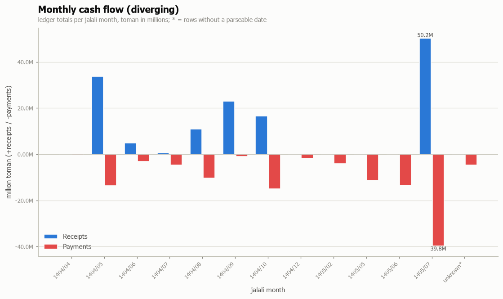
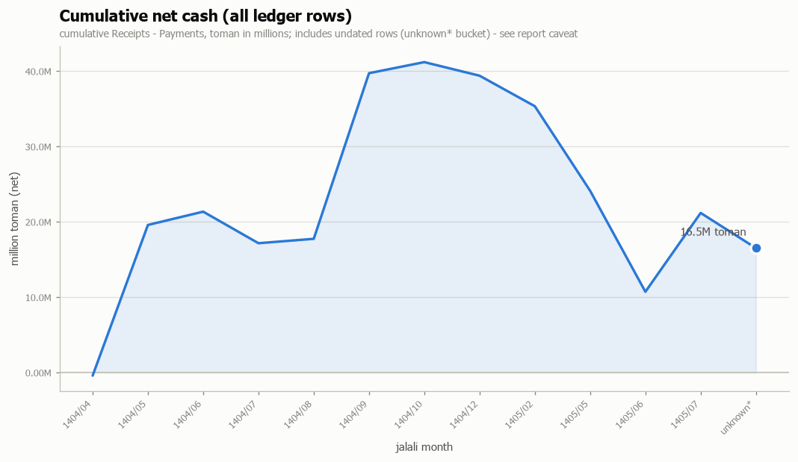

# Anjoman Financial Report — Monthly View (1404/04 – 1405/07)

**Window:** 2025-05-28 → 2026-10-14 · **Source:** reconciled ledger of 2026-10-10 (96 transactions, `Transactions.csv`). Derived view — this report does not re-audit; Review-status transactions are flagged in their own section below.

## Monthly cashflow summary (toman)

Basis: **all 96 rows, every status** — including 4 Duplicate payments, 22 Review items (among them TX0036, direction unknown) and Invoice-only rows. The headline totals beneath the table are supported-only.

| Jalali month | Gregorian range | Receipts | Payments | Net | Evidence |
|---|---|---:|---:|---:|---:|
| 1404/04 | 2025-07-19 → 2025-07-19 | — | 400,000 | -400,000 | 4 msgs |
| 1404/05 | 2025-07-24 → 2025-08-15 | 33,642,000 | 13,650,900 | 19,991,100 | 21 msgs |
| 1404/06 | 2025-09-05 → 2025-09-05 | 4,920,000 | 3,155,000 | 1,765,000 | 7 msgs |
| 1404/07 | 2025-10-01 → 2025-10-14 | 500,000 | 4,687,600 | -4,187,600 | 15 msgs |
| 1404/08 | 2025-10-25 → 2025-11-19 | 11,000,000 | 10,416,700 | 583,300 | 36 msgs |
| 1404/09 | 2025-11-23 → 2025-12-19 | 23,000,000 | 1,020,000 | 21,980,000 | 5 msgs |
| 1404/10 | 2025-12-22 → 2025-12-30 | 16,490,000 | 15,020,724 | 1,469,276 | 49 msgs |
| 1404/12 | 2026-02-28 → 2026-02-28 | — | 1,801,220 | -1,801,220 | — |
| 1405/02 | 2026-05-14 → 2026-05-17 | — | 4,050,000 | -4,050,000 | 4 msgs |
| 1405/05 | 2026-08-12 → 2026-08-13 | — | 11,217,000 | -11,217,000 | — |
| 1405/06 | 2026-08-27 → 2026-09-21 | — | 13,407,000 | -13,407,000 | — |
| 1405/07 | 2026-09-23 → 2026-10-06 | 50,235,000 | 39,775,150 | 10,459,850 | — |
| unknown* | — | — | 4,664,700 | -4,664,700 | 1 msg |
| **Total (all rows)** |  | **139,787,000** | **123,265,994** | **16,521,006** | **142 msgs** |

The unknown* month row holds the two undated transactions — TX0060 pomegranate/hospitality pre-payment invoice for Yalda (1,664,700) and TX0096 declared alenush.com domain purchase (3,000,000) — which carry no `period_jalali` and therefore share one bucket.

**Totals — supported only (headline):** receipts 112,552,000 · payments 99,085,195 · net 13,466,805 toman. Status `Supported` rows only — reproduces the 2026-10-10 report's final checks exactly (`new_payments_total` 99,085,195, `new_net_activity` 13,466,805).

**Totals — all rows:** receipts 139,787,000 · payments 123,265,994 · net 16,521,006 toman. The table basis: the headline plus 4 Duplicate payments, 22 Review items (incl. TX0036 and the declared domain purchase TX0096), 3 Invoice-only rows and the Summary-only TX0094 gross-sales receipt.

## Category schedule by month

Gross flow per month (receipts and payments summed, all 96 rows, all statuses). Month columns are Jalali; 1404 and 1405 split into two tables for width.

### 1404

| Category | 04 | 05 | 06 | 07 | 08 | 09 | 10 | 12 | Total |
|---|---|---|---|---|---|---|---|---|---|
| Advertising | 400,000 | 400,000 | — | — | — | — | — | — | 800,000 |
| Bank fees | — | 900 | — | — | — | — | — | — | 900 |
| Course fees | — | 33,642,000 | — | — | — | — | — | — | 33,642,000 |
| Donations | — | — | — | 500,000 | — | 23,000,000 | 16,490,000 | — | 39,990,000 |
| Equipment | — | 750,000 | — | — | 2,795,000 | — | — | — | 3,545,000 |
| Events | — | — | 7,975,000 | — | 5,774,000 | — | 15,020,724 | — | 28,769,724 |
| Hospitality | — | — | — | 4,597,600 | 235,000 | — | — | — | 4,832,600 |
| Opening funds | — | — | — | — | 11,000,000 | — | — | — | 11,000,000 |
| Printing | — | — | 100,000 | 90,000 | 16,600 | — | — | — | 206,600 |
| Supplies | — | — | — | — | 1,296,100 | — | — | — | 1,296,100 |
| Teaching | — | 12,500,000 | — | — | — | — | — | — | 12,500,000 |
| Unclassified | — | — | — | — | 300,000 | 1,020,000 | — | 1,801,220 | 3,121,220 |
| **All rows** | **400,000** | **47,292,900** | **8,075,000** | **5,187,600** | **21,416,700** | **24,020,000** | **31,510,724** | **1,801,220** | **139,704,144** |

### 1405 (+ undated*)

| Category | 02 | 05 | 06 | 07 | Und* | Total |
|---|---|---|---|---|---|---|
| Events | 4,050,000 | — | — | 55,235,000 | — | 59,285,000 |
| Hospitality | — | — | — | 9,987,900 | 1,664,700 | 11,652,600 |
| Supplies | — | — | — | 950,000 | — | 950,000 |
| Teaching | — | — | 8,457,000 | 7,300,000 | — | 15,757,000 |
| Unclassified | — | 11,217,000 | 4,950,000 | 16,537,250 | — | 32,704,250 |
| Website domain | — | — | — | — | 3,000,000 | 3,000,000 |
| **All rows** | **4,050,000** | **11,217,000** | **13,407,000** | **90,010,150** | **4,664,700** | **123,348,850** |

The Und* column is the undated bucket (see the monthly summary footnote); it appears once, in the second table.

## Project schedule by month

Gross flow per month (receipts and payments summed, all 96 rows, all statuses). Month columns are Jalali; 1404 and 1405 split into two tables for width.

### 1404

| Project | 04 | 05 | 06 | 07 | 08 | 09 | 10 | 12 | Total |
|---|---|---|---|---|---|---|---|---|---|
| Association operations | — | 750,000 | — | — | 13,347,700 | 23,000,000 | — | — | 37,097,700 |
| Booths 1404 | — | — | — | — | 1,995,000 | — | — | — | 1,995,000 |
| Freshman Party 1404 | — | — | — | — | 6,074,000 | — | — | — | 6,074,000 |
| Intro Event 1404 | — | — | 8,075,000 | — | — | — | — | — | 8,075,000 |
| Professors assembly Mehr | — | — | — | 2,694,750 | — | — | — | — | 2,694,750 |
| Summer School 1404 | 400,000 | 46,542,900 | — | — | — | — | — | — | 46,942,900 |
| Tea & Physics society | — | — | — | 2,492,850 | — | — | — | — | 2,492,850 |
| Unassigned | — | — | — | — | — | 1,020,000 | — | 1,801,220 | 2,821,220 |
| Yalda 1404 | — | — | — | — | — | — | 31,510,724 | — | 31,510,724 |
| **All rows** | **400,000** | **47,292,900** | **8,075,000** | **5,187,600** | **21,416,700** | **24,020,000** | **31,510,724** | **1,801,220** | **139,704,144** |

### 1405 (+ undated*)

| Project | 02 | 05 | 06 | 07 | Und* | Total |
|---|---|---|---|---|---|---|
| Association website | — | — | — | — | 3,000,000 | 3,000,000 |
| Intro Event 1405 | — | — | — | 56,185,000 | — | 56,185,000 |
| Summer School 1405 | — | — | 4,200,000 | 7,300,000 | — | 11,500,000 |
| Unassigned | — | 11,217,000 | 4,950,000 | 26,525,150 | — | 42,692,150 |
| Unknown (1405 summer school?) | — | — | 4,257,000 | — | — | 4,257,000 |
| Yalda 1404 | 4,050,000 | — | — | — | 1,664,700 | 5,714,700 |
| **All rows** | **4,050,000** | **11,217,000** | **13,407,000** | **90,010,150** | **4,664,700** | **123,348,850** |

The Und* column is the undated bucket (see the monthly summary footnote); it appears once, in the second table.

## Flagged transactions (Review status)

22 rows sit in Review — outside the supported headline, inside the all-rows tables above. The ten December-1404 event payments whose reasons are all volunteer-funded or scan-ambiguity variants are grouped; the rest follow individually.

| ID / period | Direction | Amount | Why flagged |
|---|---|---:|---|
| TX0064–TX0073 (1404/10) | Payment | 3,359,140 | Grouped: volunteer-funded or scan-ambiguous event payments (supports TX0050, TX0062/63 and the Parnian reimbursement; several may be duplicate scans of one slip) |
| TX0010 (1404/05) | Payment | 400,000 | Probable double entry of the single receipted 400,000 ad. message57 suggests Hassan logged the ad, but only one payment exists. |
| TX0018 (1404/07) | Internal transfer | — | No unit is printed. If the amount is rial (1,765,000 toman), it equals the ledger net 4,920,000-3,155,000 (M3). |
| TX0036 (1404/08) | Unknown | 300,000 | It is unclear whether this is cash collected (receipt) or cash given out (payment). The ledger records it as an expense. |
| TX0042 (1404/08) | Payment | 13,000 | Same day as TX0040/41 (12:35 vs 12:55). It may be a separate purchase, or one of the printing lines misread by a factor of 10. Not in the ledger. |
| TX0049 (1404/10) | Payment | — | Explicitly expenses or transfers, not income (message120). Payees unknown. The withdrawal line in message115 carries no unit label, while the deposit lines are labelled rial. May overlap recorded expenses. |
| TX0052 (1404/10) | Payment | 400,000 | Paid from Bardia's personal account. This is supporting detail for the TX0050 reimbursement, not association cash. |
| TX0053 (1404/10) | Payment | 250,000 | Volunteer-funded; supports TX0050. |
| TX0054 (1404/10) | Payment | 600,000 | Bardia said he lacked the 600 receipt, so the mapping is ambiguous. Supports TX0050. |
| TX0055 (1404/10) | Payment | 1,162,584 | Invoice lost. Volunteer-funded; supports TX0050. |
| TX0056 (1404/10) | Payment | 2,150,000 | Payer appears to be Hossein. No reimbursement to Hossein is evidenced, so this may be an unrecorded payable or unrecorded payment. |
| TX0058 (1404/10) | Payment | — | No receipt and no unit (likely thousand toman). Reimbursement status unknown. |
| TX0096 (undated) | Payment | 3,000,000 | Purpose and reported purchase amount confirmed by user. Purchase date, funding source and any reimbursement are unknown; not yet included in the cutoff cash totals. |

Also outside the supported headline: 4 Duplicate payments (6,129,375 toman), 3 Invoice-only rows (6,416,700 toman, incl. TX0060), and 1 Summary-only receipt (27,235,000 toman, TX0094 platform-reported gross ticket sales).

## Evidence and time-of-day notes

The Evidence column above counts ledger `message_ids` — the accounting-group messages each month's rows are linked to. Where a transaction links to messages, timestamps come from the Telegram export and are **export-local (UTC+03:30)**: they show when the treasurer posted, not necessarily when cash moved.

Accounting-group hours holding at least 5 TX-linked messages (n ≥ 5 only, 9 hours):

- 04:00 — 5 TX-linked messages
- 11:00 — 7 TX-linked messages
- 13:00 — 8 TX-linked messages
- 14:00 — 5 TX-linked messages
- 15:00 — 5 TX-linked messages
- 18:00 — 24 TX-linked messages
- 20:00 — 8 TX-linked messages
- 21:00 — 5 TX-linked messages
- 22:00 — 9 TX-linked messages

Weekday peaks in the accounting group (n ≥ 5): Saturday 18:00 (n=23), Sunday 23:00 (n=5), Monday 15:00 (n=5), Tuesday 22:00 (n=17), Thursday 20:00 (n=20), Friday 04:00 (n=7).

Caveats: these counts are **messages, not transactions**, and start-time mention counts include deadline times. Example — the money-linked association-website thread most often mentions start 13:00 (n=12), but its distinct times are 11:00, 13:00, 15:00, 18:00, 19:10, 23:59, so n counts a 23:59 deadline alongside real starts.

## Caveats

- **Net activity is not closing cash.** Cash custodianship mixes personal and association funds; opening cash and bank-reconciled closing cash remain unavailable (2026-10-10 report, remaining gaps).
- **Monthly tables are all-rows basis** (stated at the table): every status included. Only the headline totals are supported-only.
- **Review items are flagged, not resolved**: TX0096 (declared 3,000,000 domain purchase) and TX0036 (direction unknown, 300,000) stay outside supported totals until date, funding and direction are clarified.
- **Window**: 2025-05-28 → 2026-10-14 fully covers the ledger period 1404/04 – 1405/07; months with no ledger rows (1404/11, 1405/01, 1405/03, 1405/04) are omitted from the tables.
- Derived from the reconciled 2026-10-10 ledger; this report does not re-audit. Message timestamps are export-local (UTC+03:30).
