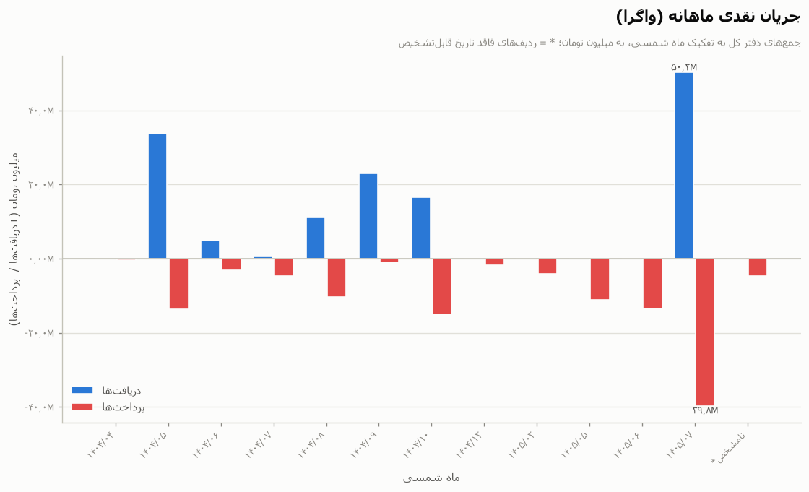
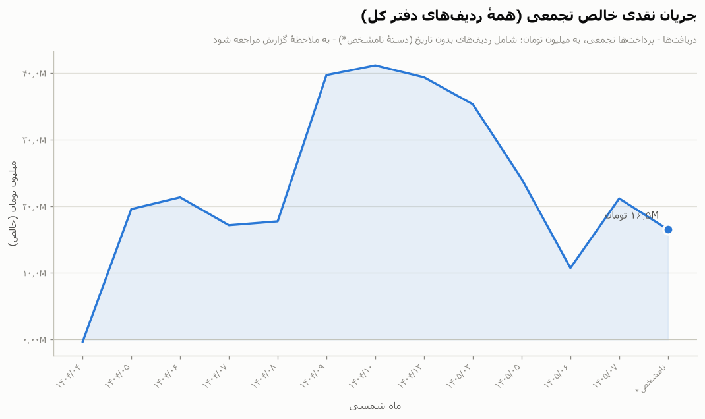

# گزارش مالی انجمن — نمای ماهانه (۱۴۰۴/۰۴ – ۱۴۰۵/۰۷)

**بازه:** ۱۴۰۴/۰۳/۰۷ ← ۱۴۰۵/۰۷/۲۲؛ **منبع:** دفتر کل تطبیق‌شده مورخ ۲۰۲۶-۱۰-۱۰ (۹۶ تراکنش، `Transactions.csv`). نمای مشتق؛ این گزارش حسابرسی مجدد انجام نمی‌دهد و تراکنش‌های دارای وضعیت «نیازمند بررسی» در بخش جداگانهٔ خود در ادامه علامت‌گذاری شده‌اند.

## خلاصهٔ جریان نقدی ماهانه (تومان)

مبنا: **همهٔ ردیف‌ها (۹۶ ردیف) با هر وضعیت** — شامل ۴ پرداخت تکراری، ۲۲ قلم نیازمند بررسی (از جمله TX0036 با جهت نامشخص) و ردیف‌های صرفاً صورتحساب. جمع‌های اصلی زیر جدول فقط بر مبنای اقلام تأییدشده است.

| ماه شمسی | بازهٔ تاریخ | دریافت‌ها | پرداخت‌ها | خالص | شواهد |
|---|---|---:|---:|---:|---:|
| ۱۴۰۴/۰۴ | ۱۴۰۴/۰۴/۲۸ ← ۱۴۰۴/۰۴/۲۸ | — | ۴۰۰٬۰۰۰ | -۴۰۰٬۰۰۰ | ۴ پیام |
| ۱۴۰۴/۰۵ | ۱۴۰۴/۰۵/۰۲ ← ۱۴۰۴/۰۵/۲۴ | ۳۳٬۶۴۲٬۰۰۰ | ۱۳٬۶۵۰٬۹۰۰ | ۱۹٬۹۹۱٬۱۰۰ | ۲۱ پیام |
| ۱۴۰۴/۰۶ | ۱۴۰۴/۰۶/۱۴ ← ۱۴۰۴/۰۶/۱۴ | ۴٬۹۲۰٬۰۰۰ | ۳٬۱۵۵٬۰۰۰ | ۱٬۷۶۵٬۰۰۰ | ۷ پیام |
| ۱۴۰۴/۰۷ | ۱۴۰۴/۰۷/۰۹ ← ۱۴۰۴/۰۷/۲۲ | ۵۰۰٬۰۰۰ | ۴٬۶۸۷٬۶۰۰ | -۴٬۱۸۷٬۶۰۰ | ۱۵ پیام |
| ۱۴۰۴/۰۸ | ۱۴۰۴/۰۸/۰۳ ← ۱۴۰۴/۰۸/۲۸ | ۱۱٬۰۰۰٬۰۰۰ | ۱۰٬۴۱۶٬۷۰۰ | ۵۸۳٬۳۰۰ | ۳۶ پیام |
| ۱۴۰۴/۰۹ | ۱۴۰۴/۰۹/۰۲ ← ۱۴۰۴/۰۹/۲۸ | ۲۳٬۰۰۰٬۰۰۰ | ۱٬۰۲۰٬۰۰۰ | ۲۱٬۹۸۰٬۰۰۰ | ۵ پیام |
| ۱۴۰۴/۱۰ | ۱۴۰۴/۱۰/۰۱ ← ۱۴۰۴/۱۰/۰۹ | ۱۶٬۴۹۰٬۰۰۰ | ۱۵٬۰۲۰٬۷۲۴ | ۱٬۴۶۹٬۲۷۶ | ۴۹ پیام |
| ۱۴۰۴/۱۲ | ۱۴۰۴/۱۲/۰۹ ← ۱۴۰۴/۱۲/۰۹ | — | ۱٬۸۰۱٬۲۲۰ | -۱٬۸۰۱٬۲۲۰ | — |
| ۱۴۰۵/۰۲ | ۱۴۰۵/۰۲/۲۴ ← ۱۴۰۵/۰۲/۲۷ | — | ۴٬۰۵۰٬۰۰۰ | -۴٬۰۵۰٬۰۰۰ | ۴ پیام |
| ۱۴۰۵/۰۵ | ۱۴۰۵/۰۵/۲۱ ← ۱۴۰۵/۰۵/۲۲ | — | ۱۱٬۲۱۷٬۰۰۰ | -۱۱٬۲۱۷٬۰۰۰ | — |
| ۱۴۰۵/۰۶ | ۱۴۰۵/۰۶/۰۵ ← ۱۴۰۵/۰۶/۳۰ | — | ۱۳٬۴۰۷٬۰۰۰ | -۱۳٬۴۰۷٬۰۰۰ | — |
| ۱۴۰۵/۰۷ | ۱۴۰۵/۰۷/۰۱ ← ۱۴۰۵/۰۷/۱۴ | ۵۰٬۲۳۵٬۰۰۰ | ۳۹٬۷۷۵٬۱۵۰ | ۱۰٬۴۵۹٬۸۵۰ | — |
| نامشخص* | — | — | ۴٬۶۶۴٬۷۰۰ | -۴٬۶۶۴٬۷۰۰ | ۱ پیام |
| **جمع (همهٔ ردیف‌ها)** |  | **۱۳۹٬۷۸۷٬۰۰۰** | **۱۲۳٬۲۶۵٬۹۹۴** | **۱۶٬۵۲۱٬۰۰۶** | **۱۴۲ پیام** |

ردیف ماه نامشخص* دو تراکنش بدون تاریخ را در بر دارد — TX0060، صورتحساب پیش‌پرداخت انار/پذیرایی برای یلدا (۱٬۶۶۴٬۷۰۰) و TX0096، خرید اعلام‌شدهٔ دامنهٔ alenush.com (۳٬۰۰۰٬۰۰۰) — که فاقد `period_jalali` هستند و از این رو در یک دسته قرار گرفته‌اند.

**جمع‌ها — فقط تأییدشده (جمع‌های اصلی):** دریافت‌ها ۱۱۲٬۵۵۲٬۰۰۰؛ پرداخت‌ها ۹۹٬۰۸۵٬۱۹۵؛ خالص ۱۳٬۴۶۶٬۸۰۵ تومان. فقط ردیف‌های با وضعیت `Supported` — بررسی‌های نهایی گزارش ۲۰۲۶-۱۰-۱۰ را دقیقاً بازتولید می‌کند (`new_payments_total` ۹۹٬۰۸۵٬۱۹۵، `new_net_activity` ۱۳٬۴۶۶٬۸۰۵).

**جمع‌ها — همهٔ ردیف‌ها:** دریافت‌ها ۱۳۹٬۷۸۷٬۰۰۰؛ پرداخت‌ها ۱۲۳٬۲۶۵٬۹۹۴؛ خالص ۱۶٬۵۲۱٬۰۰۶ تومان. مبنای جدول: جمع‌های اصلی به‌علاوهٔ ۴ پرداخت تکراری، ۲۲ قلم نیازمند بررسی (از جمله TX0036 و خرید اعلام‌شدهٔ دامنه TX0096)، ۳ ردیف صرفاً صورتحساب و دریافت فروش ناخالص TX0094 با وضعیت صرفاً گزارش تجمیعی.

## جدول دسته‌بندی‌ها به تفکیک ماه

گردش ناخالص هر ماه (مجموع دریافت‌ها و پرداخت‌ها، همهٔ ۹۶ ردیف، همهٔ وضعیت‌ها). ستون‌های ماه به تقویم جلالی‌اند؛ ۱۴۰۴ و ۱۴۰۵ به‌دلیل عرض جدول در دو جدول جداگانه آمده‌اند.

### ۱۴۰۴

| دسته‌بندی | ۰۴ | ۰۵ | ۰۶ | ۰۷ | ۰۸ | ۰۹ | ۱۰ | ۱۲ | جمع کل |
|---|---|---|---|---|---|---|---|---|---|
| تبلیغات | ۴۰۰٬۰۰۰ | ۴۰۰٬۰۰۰ | — | — | — | — | — | — | ۸۰۰٬۰۰۰ |
| کارمزدهای بانکی | — | ۹۰۰ | — | — | — | — | — | — | ۹۰۰ |
| شهریه دوره‌ها | — | ۳۳٬۶۴۲٬۰۰۰ | — | — | — | — | — | — | ۳۳٬۶۴۲٬۰۰۰ |
| کمک‌های مالی | — | — | — | ۵۰۰٬۰۰۰ | — | ۲۳٬۰۰۰٬۰۰۰ | ۱۶٬۴۹۰٬۰۰۰ | — | ۳۹٬۹۹۰٬۰۰۰ |
| تجهیزات | — | ۷۵۰٬۰۰۰ | — | — | ۲٬۷۹۵٬۰۰۰ | — | — | — | ۳٬۵۴۵٬۰۰۰ |
| رویدادها | — | — | ۷٬۹۷۵٬۰۰۰ | — | ۵٬۷۷۴٬۰۰۰ | — | ۱۵٬۰۲۰٬۷۲۴ | — | ۲۸٬۷۶۹٬۷۲۴ |
| پذیرایی | — | — | — | ۴٬۵۹۷٬۶۰۰ | ۲۳۵٬۰۰۰ | — | — | — | ۴٬۸۳۲٬۶۰۰ |
| وجوه ابتدای دوره | — | — | — | — | ۱۱٬۰۰۰٬۰۰۰ | — | — | — | ۱۱٬۰۰۰٬۰۰۰ |
| چاپ | — | — | ۱۰۰٬۰۰۰ | ۹۰٬۰۰۰ | ۱۶٬۶۰۰ | — | — | — | ۲۰۶٬۶۰۰ |
| ملزومات | — | — | — | — | ۱٬۲۹۶٬۱۰۰ | — | — | — | ۱٬۲۹۶٬۱۰۰ |
| تدریس | — | ۱۲٬۵۰۰٬۰۰۰ | — | — | — | — | — | — | ۱۲٬۵۰۰٬۰۰۰ |
| طبقه‌بندی‌نشده | — | — | — | — | ۳۰۰٬۰۰۰ | ۱٬۰۲۰٬۰۰۰ | — | ۱٬۸۰۱٬۲۲۰ | ۳٬۱۲۱٬۲۲۰ |
| **همهٔ ردیف‌ها** | **۴۰۰٬۰۰۰** | **۴۷٬۲۹۲٬۹۰۰** | **۸٬۰۷۵٬۰۰۰** | **۵٬۱۸۷٬۶۰۰** | **۲۱٬۴۱۶٬۷۰۰** | **۲۴٬۰۲۰٬۰۰۰** | **۳۱٬۵۱۰٬۷۲۴** | **۱٬۸۰۱٬۲۲۰** | **۱۳۹٬۷۰۴٬۱۴۴** |

### ۱۴۰۵ (+ بدون تاریخ*)

| دسته‌بندی | ۰۲ | ۰۵ | ۰۶ | ۰۷ | بدون تاریخ* | جمع کل |
|---|---|---|---|---|---|---|
| رویدادها | ۴٬۰۵۰٬۰۰۰ | — | — | ۵۵٬۲۳۵٬۰۰۰ | — | ۵۹٬۲۸۵٬۰۰۰ |
| پذیرایی | — | — | — | ۹٬۹۸۷٬۹۰۰ | ۱٬۶۶۴٬۷۰۰ | ۱۱٬۶۵۲٬۶۰۰ |
| ملزومات | — | — | — | ۹۵۰٬۰۰۰ | — | ۹۵۰٬۰۰۰ |
| تدریس | — | — | ۸٬۴۵۷٬۰۰۰ | ۷٬۳۰۰٬۰۰۰ | — | ۱۵٬۷۵۷٬۰۰۰ |
| طبقه‌بندی‌نشده | — | ۱۱٬۲۱۷٬۰۰۰ | ۴٬۹۵۰٬۰۰۰ | ۱۶٬۵۳۷٬۲۵۰ | — | ۳۲٬۷۰۴٬۲۵۰ |
| دامنهٔ وب‌سایت | — | — | — | — | ۳٬۰۰۰٬۰۰۰ | ۳٬۰۰۰٬۰۰۰ |
| **همهٔ ردیف‌ها** | **۴٬۰۵۰٬۰۰۰** | **۱۱٬۲۱۷٬۰۰۰** | **۱۳٬۴۰۷٬۰۰۰** | **۹۰٬۰۱۰٬۱۵۰** | **۴٬۶۶۴٬۷۰۰** | **۱۲۳٬۳۴۸٬۸۵۰** |

ستون «بدون تاریخ*» سبد اقلام بدون تاریخ است (پانوشت خلاصهٔ ماهانه را ببینید)؛ این ستون تنها یک بار، در جدول دوم، آمده است.

## جدول پروژه‌ها به تفکیک ماه

گردش ناخالص هر ماه (مجموع دریافت‌ها و پرداخت‌ها، همهٔ ۹۶ ردیف، همهٔ وضعیت‌ها). ستون‌های ماه به تقویم جلالی‌اند؛ ۱۴۰۴ و ۱۴۰۵ به‌دلیل عرض جدول در دو جدول جداگانه آمده‌اند.

### ۱۴۰۴

| پروژه | ۰۴ | ۰۵ | ۰۶ | ۰۷ | ۰۸ | ۰۹ | ۱۰ | ۱۲ | جمع کل |
|---|---|---|---|---|---|---|---|---|---|
| عملیات انجمن | — | ۷۵۰٬۰۰۰ | — | — | ۱۳٬۳۴۷٬۷۰۰ | ۲۳٬۰۰۰٬۰۰۰ | — | — | ۳۷٬۰۹۷٬۷۰۰ |
| غرفه‌های ۱۴۰۴ | — | — | — | — | ۱٬۹۹۵٬۰۰۰ | — | — | — | ۱٬۹۹۵٬۰۰۰ |
| جشن ورودی‌های ۱۴۰۴ | — | — | — | — | ۶٬۰۷۴٬۰۰۰ | — | — | — | ۶٬۰۷۴٬۰۰۰ |
| برنامهٔ معارفه ۱۴۰۴ | — | — | ۸٬۰۷۵٬۰۰۰ | — | — | — | — | — | ۸٬۰۷۵٬۰۰۰ |
| مجمع اساتید مهر | — | — | — | ۲٬۶۹۴٬۷۵۰ | — | — | — | — | ۲٬۶۹۴٬۷۵۰ |
| مدرسه تابستانه ۱۴۰۴ | ۴۰۰٬۰۰۰ | ۴۶٬۵۴۲٬۹۰۰ | — | — | — | — | — | — | ۴۶٬۹۴۲٬۹۰۰ |
| انجمن چای و فیزیک | — | — | — | ۲٬۴۹۲٬۸۵۰ | — | — | — | — | ۲٬۴۹۲٬۸۵۰ |
| تخصیص‌نیافته | — | — | — | — | — | ۱٬۰۲۰٬۰۰۰ | — | ۱٬۸۰۱٬۲۲۰ | ۲٬۸۲۱٬۲۲۰ |
| یلدا ۱۴۰۴ | — | — | — | — | — | — | ۳۱٬۵۱۰٬۷۲۴ | — | ۳۱٬۵۱۰٬۷۲۴ |
| **همهٔ ردیف‌ها** | **۴۰۰٬۰۰۰** | **۴۷٬۲۹۲٬۹۰۰** | **۸٬۰۷۵٬۰۰۰** | **۵٬۱۸۷٬۶۰۰** | **۲۱٬۴۱۶٬۷۰۰** | **۲۴٬۰۲۰٬۰۰۰** | **۳۱٬۵۱۰٬۷۲۴** | **۱٬۸۰۱٬۲۲۰** | **۱۳۹٬۷۰۴٬۱۴۴** |

### ۱۴۰۵ (+ بدون تاریخ*)

| پروژه | ۰۲ | ۰۵ | ۰۶ | ۰۷ | بدون تاریخ* | جمع کل |
|---|---|---|---|---|---|---|
| وب‌سایت انجمن | — | — | — | — | ۳٬۰۰۰٬۰۰۰ | ۳٬۰۰۰٬۰۰۰ |
| برنامهٔ معارفه ۱۴۰۵ | — | — | — | ۵۶٬۱۸۵٬۰۰۰ | — | ۵۶٬۱۸۵٬۰۰۰ |
| مدرسه تابستانه ۱۴۰۵ | — | — | ۴٬۲۰۰٬۰۰۰ | ۷٬۳۰۰٬۰۰۰ | — | ۱۱٬۵۰۰٬۰۰۰ |
| تخصیص‌نیافته | — | ۱۱٬۲۱۷٬۰۰۰ | ۴٬۹۵۰٬۰۰۰ | ۲۶٬۵۲۵٬۱۵۰ | — | ۴۲٬۶۹۲٬۱۵۰ |
| نامشخص (احتمالاً مدرسه تابستانی ۱۴۰۵) | — | — | ۴٬۲۵۷٬۰۰۰ | — | — | ۴٬۲۵۷٬۰۰۰ |
| یلدا ۱۴۰۴ | ۴٬۰۵۰٬۰۰۰ | — | — | — | ۱٬۶۶۴٬۷۰۰ | ۵٬۷۱۴٬۷۰۰ |
| **همهٔ ردیف‌ها** | **۴٬۰۵۰٬۰۰۰** | **۱۱٬۲۱۷٬۰۰۰** | **۱۳٬۴۰۷٬۰۰۰** | **۹۰٬۰۱۰٬۱۵۰** | **۴٬۶۶۴٬۷۰۰** | **۱۲۳٬۳۴۸٬۸۵۰** |

ستون «بدون تاریخ*» سبد اقلام بدون تاریخ است (پانوشت خلاصهٔ ماهانه را ببینید)؛ این ستون تنها یک بار، در جدول دوم، آمده است.

## تراکنش‌های علامت‌گذاری‌شده (وضعیت نیازمند بررسی)

۲۲ ردیف در وضعیت «نیازمند بررسی» قرار دارند؛ بیرون از جمع‌های اصلی تأییدشده، اما درون جدول‌های همهٔ ردیف‌ها در بالا. ده پرداخت رویدادی دسامبر ۱۴۰۴ که علت‌هایشان همگی از گونه‌های تأمین مالی داوطلبانه یا ابهام اسکن است، گروه‌بندی شده‌اند؛ باقی موارد به‌صورت جداگانه آمده‌اند.

| شناسه / دوره | جهت | مبلغ | علت علامت‌گذاری |
|---|---|---:|---|
| TX0064–TX0073 (۱۴۰۴/۱۰) | پرداخت | ۳٬۳۵۹٬۱۴۰ | گروه‌بندی‌شده: پرداخت‌های رویداد با تأمین مالی داوطلبان یا دارای ابهام در اسکن (مستندکنندهٔ TX0050، TX0062/۶۳ و بازپرداخت Parnian؛ ممکن است چند مورد، اسکن تکراری یک رسید واحد باشند) |
| TX0010 (۱۴۰۴/۰۵) | پرداخت | ۴۰۰٬۰۰۰ | ثبت مضاعف احتمالی تبلیغ ۴۰۰٬۰۰۰ تومانی دارای رسید. پیام ۵۷ نشان می‌دهد حسن تبلیغ را ثبت کرده است، اما فقط یک پرداخت وجود دارد. |
| TX0018 (۱۴۰۴/۰۷) | انتقال داخلی | — | واحدی درج نشده است. اگر مبلغ ریال باشد (۱٬۷۶۵٬۰۰۰ تومان)، با خالص دفتر ۴٬۹۲۰٬۰۰۰-۳٬۱۵۵٬۰۰۰ (M3) برابر است. |
| TX0036 (۱۴۰۴/۰۸) | نامشخص | ۳۰۰٬۰۰۰ | مشخص نیست که این مبلغ وجه نقد دریافتی (دریافت) است یا وجه نقد پرداختی (پرداخت). دفتر کل آن را به‌عنوان هزینه ثبت کرده است. |
| TX0042 (۱۴۰۴/۰۸) | پرداخت | ۱۳٬۰۰۰ | همان روز TX0040/۴۱ (۱۲:۳۵ در برابر ۱۲:۵۵). ممکن است خرید جداگانه‌ای باشد یا یکی از ردیف‌های چاپ با ضریب ۱۰ اشتباه خوانده شده باشد. در دفتر ثبت نشده است. |
| TX0049 (۱۴۰۴/۱۰) | پرداخت | — | صراحتاً هزینه یا انتقال هستند، نه درآمد (message120). دریافت‌کنندگان نامشخص‌اند. در سطر برداشت در message115 واحدی ذکر نشده، در حالی که سطرهای واریز با ریال برچسب‌گذاری شده‌اند. ممکن است با هزینه‌های ثبت‌شده همپوشانی داشته باشد. |
| TX0052 (۱۴۰۴/۱۰) | پرداخت | ۴۰۰٬۰۰۰ | از حساب شخصی بردیا پرداخت شده است. این مورد جزئیات پشتیبان بازپرداخت TX0050 است، نه وجه نقد انجمن. |
| TX0053 (۱۴۰۴/۱۰) | پرداخت | ۲۵۰٬۰۰۰ | با هزینه داوطلب؛ پشتیبان TX0050. |
| TX0054 (۱۴۰۴/۱۰) | پرداخت | ۶۰۰٬۰۰۰ | بردیا گفت رسید ۶۰۰ را در اختیار نداشته است، بنابراین تطبیق مبهم است. پشتیبان TX0050 است. |
| TX0055 (۱۴۰۴/۱۰) | پرداخت | ۱٬۱۶۲٬۵۸۴ | فاکتور گم شده است. با هزینه داوطلبان تأمین شده؛ از TX0050 پشتیبانی می‌کند. |
| TX0056 (۱۴۰۴/۱۰) | پرداخت | ۲٬۱۵۰٬۰۰۰ | به نظر می‌رسد پرداخت‌کننده حسین است. بازپرداختی به حسین مستند نشده است، بنابراین ممکن است این مورد یک بدهی ثبت‌نشده یا یک پرداخت ثبت‌نشده باشد. |
| TX0058 (۱۴۰۴/۱۰) | پرداخت | — | رسید و واحد وجود ندارد (احتمالاً هزار تومان). وضعیت بازپرداخت نامشخص است. |
| TX0096 (بدون تاریخ) | پرداخت | ۳٬۰۰۰٬۰۰۰ | هدف و مبلغ گزارش‌شده خرید توسط کاربر تأیید شده است. تاریخ خرید، منبع تأمین مالی و هرگونه بازپرداخت نامشخص است؛ هنوز در مجموع‌های نقدی تا تاریخ قطع محاسبات لحاظ نشده است. |

همچنین بیرون از جمع‌های اصلی تأییدشده: ۴ پرداخت تکراری (۶٬۱۲۹٬۳۷۵ تومان)، ۳ ردیف صرفاً صورتحساب (۶٬۴۱۶٬۷۰۰ تومان، شامل TX0060) و ۱ دریافت صرفاً گزارش تجمیعی (۲۷٬۲۳۵٬۰۰۰ تومان، TX0094: فروش ناخالص بلیت گزارش‌شده از سوی پلتفرم).

## شواهد و نکات مربوط به ساعت روز

ستون «شواهد» در بالا `message_ids` دفتر کل را می‌شمارد؛ یعنی پیام‌هایی از گروه حسابداری که ردیف‌های هر ماه به آن‌ها پیوند دارند. هرگاه تراکنشی به پیام‌هایی پیوند داشته باشد، برچسب‌های زمانی از خروجی تلگرام گرفته شده‌اند و **به وقت محلی خروجی (UTC+۰۳:۳۰)** هستند: این زمان‌ها نشان می‌دهند خزانه‌دار چه زمانی پیام را ارسال کرده است، نه لزوماً زمان جابه‌جایی وجه.

ساعت‌هایی از گروه حسابداری که دست‌کم ۵ پیام مرتبط با تراکنش (TX) دارند (فقط n ≥ ۵، ۹ ساعت):

- ۰۴:۰۰ — ۵ پیام مرتبط با تراکنش (TX)
- ۱۱:۰۰ — ۷ پیام مرتبط با تراکنش (TX)
- ۱۳:۰۰ — ۸ پیام مرتبط با تراکنش (TX)
- ۱۴:۰۰ — ۵ پیام مرتبط با تراکنش (TX)
- ۱۵:۰۰ — ۵ پیام مرتبط با تراکنش (TX)
- ۱۸:۰۰ — ۲۴ پیام مرتبط با تراکنش (TX)
- ۲۰:۰۰ — ۸ پیام مرتبط با تراکنش (TX)
- ۲۱:۰۰ — ۵ پیام مرتبط با تراکنش (TX)
- ۲۲:۰۰ — ۹ پیام مرتبط با تراکنش (TX)

اوج روز هفته در گروه حسابداری (n ≥ ۵): شنبه ۱۸:۰۰ (n=۲۳)، یک‌شنبه ۲۳:۰۰ (n=۵)، دوشنبه ۱۵:۰۰ (n=۵)، سه‌شنبه ۲۲:۰۰ (n=۱۷)، پنج‌شنبه ۲۰:۰۰ (n=۲۰)، جمعه ۰۴:۰۰ (n=۷).

ملاحظات: این شمارش‌ها **پیام‌اند، نه تراکنش**، و شمارش اشاره به ساعت شروع، ساعت‌های مهلت را نیز در بر می‌گیرد. برای نمونه — رشته (موضوع) وب‌سایت انجمن که با امور مالی پیوند دارد، بیش از همه به ساعت شروع ۱۳:۰۰ اشاره می‌کند (n=۱۲)، اما ساعت‌های متمایز آن ۱۱:۰۰، ۱۳:۰۰، ۱۵:۰۰، ۱۸:۰۰، ۱۹:۱۰، ۲۳:۵۹ است؛ بنابراین n یک مهلت ۲۳:۵۹ را در کنار ساعت‌های شروع واقعی می‌شمارد.

## ملاحظات

- **فعالیت خالص به معنای موجودی نقدی پایانی نیست.** در نگهداری وجه نقد، وجوه شخصی و وجوه انجمن درهم آمیخته است؛ موجودی نقدی ابتدای دوره و موجودی نقدی پایانی تطبیق‌شده با بانک همچنان در دسترس نیست (گزارش ۲۰۲۶-۱۰-۱۰، کاستی‌های باقی‌مانده).
- **جدول‌های ماهانه بر مبنای همهٔ ردیف‌ها هستند** (در کنار جدول ذکر شده است): همهٔ وضعیت‌ها لحاظ شده‌اند. تنها جمع‌های اصلی صرفاً شامل اقلام تأییدشده‌اند.
- **اقلام نیازمند بررسی علامت‌گذاری شده‌اند، نه حل‌وفصل**: TX0096 (خرید اعلام‌شدهٔ دامنه به مبلغ ۳٬۰۰۰٬۰۰۰) و TX0036 (جهت نامشخص، ۳۰۰٬۰۰۰) تا روشن شدن تاریخ، منبع تأمین و جهت، خارج از جمع‌های تأییدشده باقی می‌مانند.
- **بازه**: ۱۴۰۴/۰۳/۰۷ ← ۱۴۰۵/۰۷/۲۲ دورهٔ دفتر کل ۱۴۰۴/۰۴ – ۱۴۰۵/۰۷ را به‌طور کامل پوشش می‌دهد؛ ماه‌های فاقد ردیف در دفتر کل (۱۴۰۴/۱۱، ۱۴۰۵/۰۱، ۱۴۰۵/۰۳، ۱۴۰۵/۰۴) از جدول‌ها حذف شده‌اند.
- برگرفته از دفتر کل تطبیق‌شدهٔ ۲۰۲۶-۱۰-۱۰؛ این گزارش حسابرسی مجدد انجام نمی‌دهد. مهرهای زمانی پیام‌ها به وقت محلی خروجی (UTC+۰۳:۳۰) هستند.
