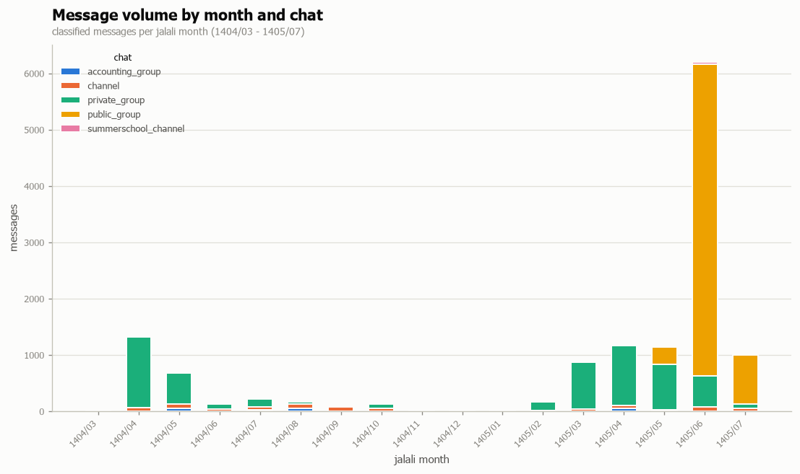
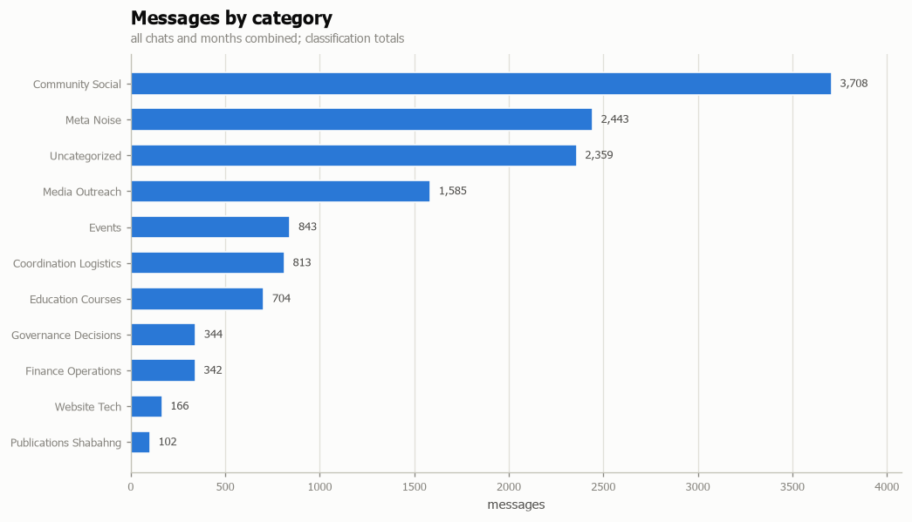
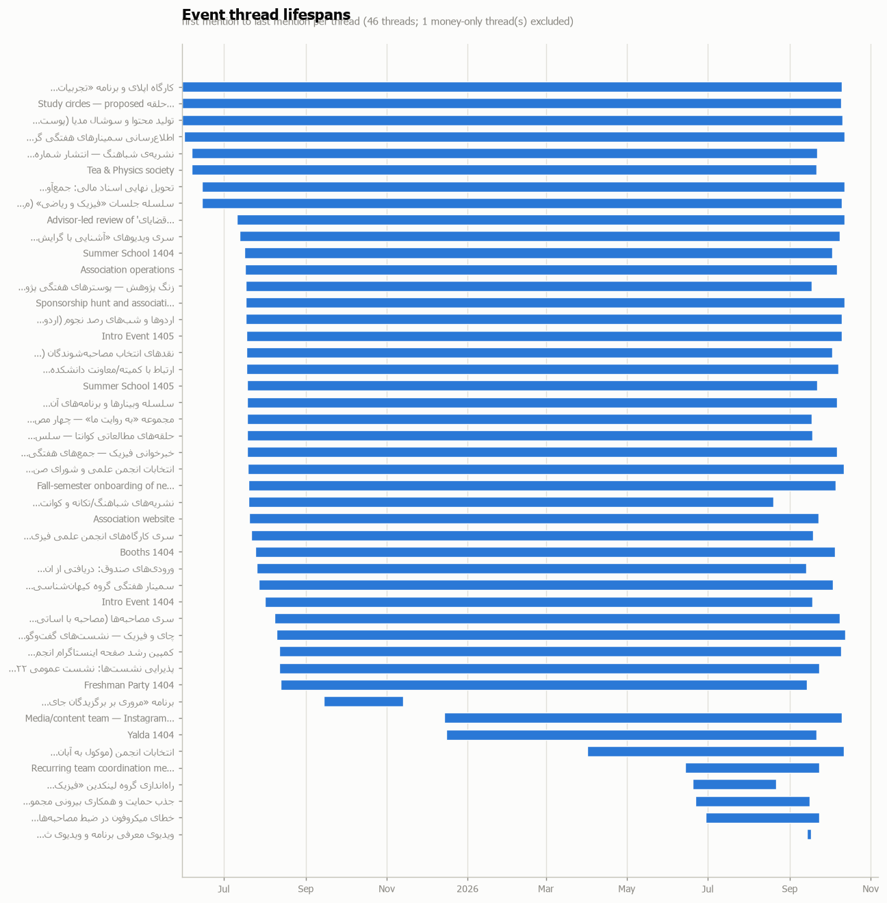
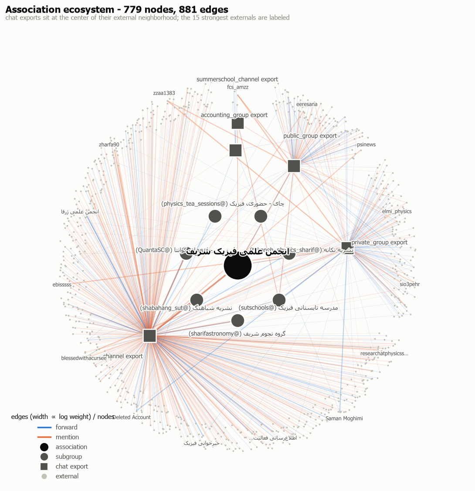
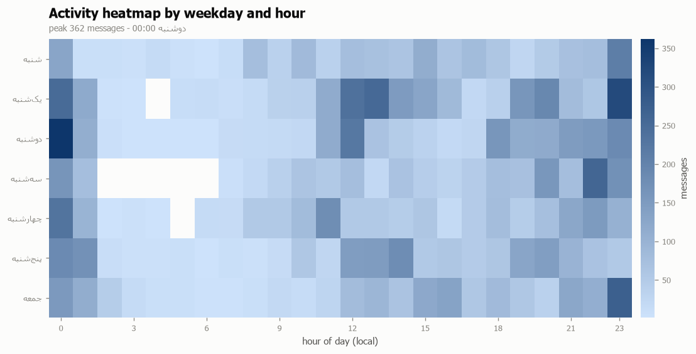
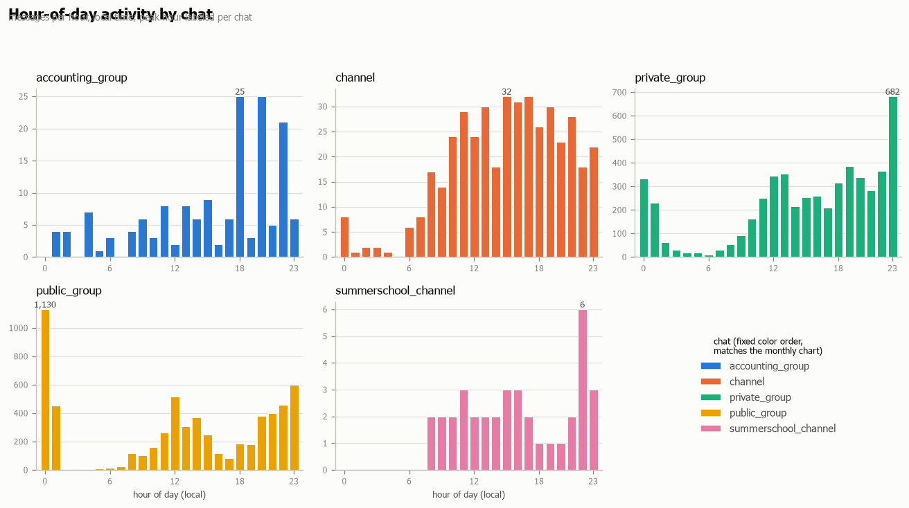

# Anjoman Performance & Activity Report (2025-05-28 → 2026-10-14)

Window 2025-05-28 → 2026-10-14 (1404/03/07 → 1405/07/22), five Telegram exports. Assembled from the analysis artifacts only: `timeline.json` (47 threads, 17 Jalali months, 45 mechanics), `ecosystem.json` (779 nodes / 881 edges), `classified.jsonl` (16,677 records; 12,066 in-window non-service), `classification_stats.json`, `threads.json`, and the source profiles consumed here (channel, summerschool_channel, ledger, docx). Figures render the Task-11 charts.

## 1. Executive summary

Across the analysis window the five Telegram exports carry **12,066 in-window, non-service messages** (of 16,677 parsed records; classification coverage 80% in-window).

Messages by chat (in-window, non-service):

| Chat | Messages | Share |
|---|---|---|
| public_group | 6,136 | 50.9% |
| private_group | 5,309 | 44.0% |
| channel | 426 | 3.5% |
| accounting_group | 158 | 1.3% |
| summerschool_channel | 37 | 0.3% |

The three largest activity categories by label count are **community_social** (3,708), **meta_noise** (2,443) and **uncategorized** (2,359) of 13,409 total labelings (multi-label; see §7). The correlation stage tracks **47 threads** (46 message-bearing + 1 money-only), and the reconciled ledger behind them moves **139,787,000 toman receipts against 123,265,994 toman payments** (net **+16,521,006**, all 96 rows, including the 4,664,700 toman undated bucket).

Five headline threads by affiliated message count:

| Thread | Title | First → last seen | Chats | Msgs | TX total (toman) |
|---|---|---|---|---|---|
| `intro-event-1405` | Intro Event 1405 | 2025-07-17 → 2026-10-09 | 5 | 752 | 56,185,000 |
| `final-receipt-handover-1405` | تحویل نهایی اسناد مالی: جمع‌آوری عکس همه فاک… | 2025-06-14 → 2026-10-12 | 5 | 413 | — |
| `media-social-content` | تولید محتوا و سوشال مدیا (پوستر/پست/اینستا، … | 2025-05-30 → 2026-10-10 | 5 | 385 | — |
| `summer-school-1404` | Summer School 1404 | 2025-07-16 → 2026-10-02 | 5 | 231 | 46,942,900 |
| `dept-weekly-seminars` | اطلاع‌رسانی سمینارهای هفتگی گروه‌های دانشکده… | 2025-05-31 → 2026-10-12 | 3 | 208 | — |

## 2. Phase narrative

Thread first-seen dates and monthly activity split the window into four phases (Jalali months; the window opens 1404/03/07 = 2025-05-28). First-seen dates derive from affiliated messages, so they inherit the §7 affiliation caveat.

*Window-opening stub:* the partial month(s) 1404/03 carry 14 messages and the first-seen of 8 threads (largest: `final-receipt-handover-1405`, 413 messages); they precede the four phases below.

### Summer 1404 (1404/04–1404/06)

**Summer 1404** spans Jalali 1404/04–1404/06 with **1,962 messages** across the chats; the busiest surface is private_group (1,788 messages) and the dominant labels are meta_noise (622) and community_social (510). 30 threads first appear in this phase, led by `intro-event-1405` (first seen 2025-07-17 / 1404/04/26, 752 messages over 5 chats). The phase's peak month is 1404/04 (1,259 messages).

| Thread | First seen | Jalali | Msgs | Chats | Last seen |
|---|---|---|---|---|---|
| `intro-event-1405` | 2025-07-17 | 1404/04/26 | 752 | 5 | 2026-10-09 |
| `summer-school-1404` | 2025-07-16 | 1404/04/25 | 231 | 5 | 2026-10-02 |
| `astro-trips-observing` | 2025-07-17 | 1404/04/26 | 139 | 5 | 2026-10-10 |
| `sponsorship-room-renovation` | 2025-07-17 | 1404/04/26 | 123 | 3 | 2026-10-12 |
| `orientation-videos-2025` | 2025-07-12 | 1404/04/21 | 103 | 3 | 2026-10-08 |

### Academic 1404-05 (1404/07–1405/03)

**Academic 1404-05** spans Jalali 1404/07–1405/03 with **1,467 messages** across the chats; the busiest surface is private_group (1,181 messages) and the dominant labels are meta_noise (340) and community_social (340). 6 threads first appear in this phase, led by `media-team-content-pipeline` (first seen 2025-12-14 / 1404/09/23, 65 messages over 2 chats). The phase's peak month is 1405/03 (784 messages).

| Thread | First seen | Jalali | Msgs | Chats | Last seen |
|---|---|---|---|---|---|
| `media-team-content-pipeline` | 2025-12-14 | 1404/09/23 | 65 | 2 | 2026-10-09 |
| `elections-1405` | 2026-04-01 | 1405/01/12 | 61 | 3 | 2026-10-11 |
| `weekly-coordination-meeting-21h` | 2026-06-13 | 1405/03/23 | 14 | 2 | 2026-09-22 |
| `linkedin-alumni-group` | 2026-06-19 | 1405/03/29 | 10 | 1 | 2026-08-21 |
| `yalda-1404` | 2025-12-15 | 1404/09/24 | 9 | 3 | 2026-09-20 |

### Summer 1405 (1405/04–1405/06)

**Summer 1405** spans Jalali 1405/04–1405/06 with **7,747 messages** across the chats; the busiest surface is public_group (5,355 messages) and the dominant labels are community_social (2,613) and uncategorized (1,558). 2 threads first appear in this phase, led by `intro-and-registration-videos` (first seen 2026-09-14 / 1405/06/23, 126 messages over 1 chat). The phase's peak month is 1405/06 (5,638 messages).

| Thread | First seen | Jalali | Msgs | Chats | Last seen |
|---|---|---|---|---|---|
| `intro-and-registration-videos` | 2026-09-14 | 1405/06/23 | 126 | 1 | 2026-09-16 |
| `mic-failure-voice-loss` | 2026-06-29 | 1405/04/08 | 3 | 2 | 2026-09-23 |

### Fall 1405 (1405/07–1405/07)

**Fall 1405** spans Jalali 1405/07–1405/07 with **876 messages** across the chats; the busiest surface is public_group (781 messages) and the dominant labels are community_social (243) and meta_noise (192). No new threads first appear in this phase. The phase's peak month is 1405/07 (876 messages).

## 3. Activity categories

Monthly labelings per category, aggregated over chats (`monthly_activity`; a message with several labels counts once per label — 13,409 labelings over the 12,066 in-window messages).

**1404** (columns are Jalali month MM)

| Category | 03 | 04 | 05 | 06 | 07 | 08 | 09 | 10 | 11 | 12 | Total |
|---|---|---|---|---|---|---|---|---|---|---|---|
| community_social | 2 | 316 | 169 | 25 | 36 | 23 | 9 | 29 | 5 | — | **3,708** |
| meta_noise | — | 443 | 162 | 17 | 49 | 13 | 4 | 20 | 3 | 2 | **2,443** |
| uncategorized | — | 199 | 101 | 7 | 24 | 15 | 3 | 20 | 1 | 4 | **2,359** |
| media_outreach | 2 | 64 | 37 | 21 | 15 | 16 | 13 | 11 | 2 | 3 | **1,585** |
| events | 5 | 11 | 52 | 16 | 32 | 42 | 30 | 16 | 1 | — | **843** |
| coordination_logistics | 2 | 74 | 27 | 8 | 19 | 16 | 7 | 4 | 3 | — | **813** |
| education_courses | 10 | 133 | 72 | 19 | 19 | 14 | 9 | 9 | 1 | — | **704** |
| governance_decisions | — | 9 | 12 | 6 | 9 | 8 | 6 | 9 | 2 | 1 | **344** |
| finance_operations | 1 | 53 | 32 | — | 11 | 21 | 1 | 2 | 4 | 3 | **342** |
| website_tech | — | 47 | 3 | 6 | 1 | 2 | 1 | 4 | — | — | **166** |
| publications_shabahng | — | 2 | 16 | 1 | 4 | 2 | — | 2 | — | 1 | **102** |
| **All labelings** | **22** | **1,351** | **683** | **126** | **219** | **172** | **83** | **126** | **22** | **14** | **13,409** |

**1405** (columns are Jalali month MM)

| Category | 01 | 02 | 03 | 04 | 05 | 06 | 07 | Total |
|---|---|---|---|---|---|---|---|---|
| community_social | 19 | 49 | 170 | 180 | 363 | 2,070 | 243 | **3,708** |
| meta_noise | 3 | 31 | 215 | 331 | 160 | 798 | 192 | **2,443** |
| uncategorized | 8 | 44 | 216 | 272 | 221 | 1,065 | 159 | **2,359** |
| media_outreach | 1 | 15 | 49 | 133 | 203 | 886 | 114 | **1,585** |
| events | 7 | 2 | 46 | 44 | 19 | 427 | 93 | **843** |
| coordination_logistics | 1 | 3 | 37 | 67 | 57 | 407 | 81 | **813** |
| education_courses | — | 8 | 41 | 37 | 70 | 225 | 37 | **704** |
| governance_decisions | 3 | 15 | 67 | 58 | 25 | 65 | 49 | **344** |
| finance_operations | 2 | 1 | 8 | 16 | 4 | 170 | 13 | **342** |
| website_tech | — | 1 | 3 | 12 | 5 | 59 | 22 | **166** |
| publications_shabahng | — | — | 18 | 17 | 10 | 27 | 2 | **102** |
| **All labelings** | **44** | **169** | **870** | **1,167** | **1,137** | **6,199** | **1,005** | **13,409** |

Most-engaged threads per category, from the **1,187 explicitly affiliated** messages (LLM `event_ref`; affiliation is conversational, not an evidence link — see §7):

| Category | Labelings | Share | Peak month | Explicitly affiliated | Top threads by explicit affiliation (messages) |
|---|---|---|---|---|---|
| community_social | 3,708 | 27.7% | 1405/06 | 305 | `intro-event-1405` (191), `summer-school-1404` (38), `intro-and-registration-videos` (24) |
| meta_noise | 2,443 | 18.2% | 1405/06 | 1 | `intro-event-1405` (1) |
| uncategorized | 2,359 | 17.6% | 1405/06 | 0 | *(none explicitly affiliated)* |
| media_outreach | 1,585 | 11.8% | 1405/06 | 300 | `intro-event-1405` (107), `intro-and-registration-videos` (102), `media-team-content-pipeline` (54) |
| events | 843 | 6.3% | 1405/06 | 230 | `intro-event-1405` (218), `tea-physics-society` (4), `apply-workshop` (3) |
| coordination_logistics | 813 | 6.1% | 1405/06 | 373 | `intro-event-1405` (232), `summer-school-1404` (76), `sponsorship-room-renovation` (24) |
| education_courses | 704 | 5.3% | 1405/06 | 76 | `summer-school-1404` (40), `summer-school-1405` (29), `calculus-study-circle` (4) |
| governance_decisions | 344 | 2.6% | 1405/03 | 15 | `elections-1405` (6), `linkedin-alumni-group` (5), `intro-event-1405` (2) |
| finance_operations | 342 | 2.6% | 1405/06 | 52 | `intro-event-1405` (22), `summer-school-1404` (15), `sponsorship-room-renovation` (12) |
| website_tech | 166 | 1.2% | 1405/06 | 40 | `intro-event-1405` (16), `summer-school-1404` (10), `summer-school-1405` (9) |
| publications_shabahng | 102 | 0.8% | 1405/06 | 2 | `shabahang-journals-funding` (2) |

## 4. Cross-chat correlation

All 46 message-bearing threads with their per-chat spread, announcement lag and linked ledger money. `Explicit` counts messages whose LLM `event_ref` names the thread; the remainder of `Msgs` is keyword-fallback membership (2,734 of the 3,921 affiliations), so fallback-heavy threads carry approximate message counts and lags (§7). `Lag` = days from the earliest non-channel chat first to the channel first; negative means the channel announcement preceded other-chat coordination.

| Thread | First seen | Chats | Msgs | Explicit | Lag (d) | TX total (toman) |
|---|---|---|---|---|---|---|
| `intro-event-1405` | 2025-07-17 | 5 | 752 | 662 | +0 | 56,185,000 |
| `final-receipt-handover-1405` | 2025-06-14 | 5 | 413 | 1 | -33 | — |
| `media-social-content` | 2025-05-30 | 5 | 385 | 1 | -48 | — |
| `summer-school-1404` | 2025-07-16 | 5 | 231 | 169 | +0 | 46,942,900 |
| `dept-weekly-seminars` | 2025-05-31 | 3 | 208 | 0 | -48 | — |
| `physics-math-circle` | 2025-06-14 | 5 | 167 | 0 | -33 | — |
| `astro-trips-observing` | 2025-07-17 | 5 | 139 | 0 | +0 | — |
| `intro-and-registration-videos` | 2026-09-14 | 1 | 126 | 126 | — | — |
| `sponsorship-room-renovation` | 2025-07-17 | 3 | 123 | 35 | +151 | — |
| `apply-workshop` | 2025-05-30 | 3 | 121 | 11 | -49 | — |
| `orientation-videos-2025` | 2025-07-12 | 3 | 103 | 0 | -12 | — |
| `association-website` | 2025-07-20 | 4 | 91 | 2 | +5 | 3,000,000 |
| `summer-school-1405` | 2025-07-18 | 3 | 81 | 63 | — | 11,500,000 |
| `interview-selection-critique` | 2025-07-18 | 4 | 78 | 0 | +89 | — |
| `instagram-growth-campaign` | 2025-08-11 | 4 | 65 | 3 | +89 | — |
| `media-team-content-pipeline` | 2025-12-14 | 2 | 65 | 61 | — | — |
| `interview-series` | 2025-08-08 | 4 | 62 | 1 | +23 | — |
| `elections-1405` | 2026-04-01 | 3 | 61 | 6 | -71 | — |
| `hospitality-sessions-1404` | 2025-08-11 | 3 | 57 | 0 | — | — |
| `faculty-committee-liaison` | 2025-07-18 | 4 | 56 | 0 | +86 | — |
| `october-advisor-review` | 2025-07-10 | 3 | 51 | 0 | -8 | — |
| `quanta-study-circles` | 2025-07-18 | 2 | 50 | 10 | — | — |
| `welcome-semester-onboarding` | 2025-07-19 | 3 | 50 | 2 | — | — |
| `shabahang-journal` | 2025-06-06 | 4 | 36 | 0 | -42 | — |
| `tea-physics-society` | 2025-06-06 | 3 | 36 | 13 | -41 | 2,492,850 |
| `covid-webinar-series` | 2025-07-18 | 3 | 36 | 0 | +4 | — |
| `physics-newsreading` | 2025-07-18 | 4 | 29 | 0 | +424 | — |
| `association-elections` | 2025-07-18 | 3 | 27 | 0 | +164 | — |
| `cosmology-weekly-seminar` | 2025-07-27 | 3 | 27 | 0 | -15 | — |
| `calculus-study-circle` | 2025-05-30 | 3 | 26 | 4 | -223 | — |
| `association-operations` | 2025-07-16 | 4 | 24 | 0 | -103 | 37,097,700 |
| `workshop-series` | 2025-07-21 | 3 | 15 | 0 | +162 | — |
| `booths-1404` | 2025-07-24 | 4 | 14 | 0 | +45 | 1,995,000 |
| `weekly-coordination-meeting-21h` | 2026-06-13 | 2 | 14 | 4 | — | — |
| `beh-royat-ma-interview-series` | 2025-07-18 | 3 | 13 | 0 | +3 | — |
| `tea-and-physics` | 2025-08-09 | 3 | 13 | 0 | +319 | — |
| `linkedin-alumni-group` | 2026-06-19 | 1 | 10 | 9 | — | — |
| `research-bell-photos` | 2025-07-17 | 3 | 9 | 0 | +117 | — |
| `intro-event-1404` | 2025-07-31 | 4 | 9 | 1 | +36 | 8,075,000 |
| `yalda-1404` | 2025-12-15 | 3 | 9 | 0 | -153 | 37,225,424 |
| `kava-external-partnership` | 2026-06-21 | 2 | 9 | 0 | — | — |
| `shabahang-journals-funding` | 2025-07-19 | 2 | 8 | 2 | +15 | — |
| `inflows-donations-legacy-funds` | 2025-07-25 | 3 | 7 | 0 | +351 | — |
| `freshman-party-1404` | 2025-08-12 | 3 | 6 | 0 | — | 6,074,000 |
| `nobel-review-series` | 2025-09-14 | 2 | 5 | 0 | -19 | — |
| `mic-failure-voice-loss` | 2026-06-29 | 2 | 3 | 0 | — | — |

**Money without matched messages — coverage gap:** `professors-assembly-mehr` (Professors assembly Mehr) carries 4 ledger rows (2,694,750 toman gross: 500,000 receipts, 2,194,750 payments; TX0019, TX0020, TX0024, TX0025) but zero keyword- or LLM-matched messages, so it is kept money-only with null first/last/lag. TX0025 is status *Duplicate* in the ledger, inflating the gross by its amount.

The three case studies below are the threads spanning the most chats (all five; tie-broken by linked transaction volume, then message count).

### Case study: `intro-event-1405` — Intro Event 1405

752 affiliated messages across 5 chats, 2025-07-17 → 2026-10-09 (1404/04/26 → 1405/07/17); announcement lag **+0 days** (channel first 2025-07-17). Explicit affiliation: 662 of 752 messages (88.0%); the remaining 90 are keyword-fallback memberships.
Ledger money behind the thread: 56,185,000 toman gross across 4 transactions (50,235,000 receipts / 5,950,000 payments).

| Stage | Date | Reference | Evidence |
|---|---|---|---|
| Planning — earliest explicit affiliation | 2026-05-25T21:41 | private_group#message9715 | [media: voice] |
| Announcement — first channel post (11 msgs) | 2025-07-17T21:31 | *(chat first, keyword-matched)* | chat first 2025-07-17; earliest explicit channel#message3497 2026-09-22 |
| Work — first message in summerschool_channel (4 msgs) | 2025-07-18T15:58 | *(chat first, keyword-matched)* | first message in this chat |
| Work — first message in private_group (46 msgs) | 2025-07-20T00:00 | *(chat first, keyword-matched)* | chat first 2025-07-20; earliest explicit private_group#message9715 2026-05-25 |
| Work — first message in accounting_group (1 msgs) | 2025-09-27T11:43 | *(chat first, keyword-matched)* | first message in this chat |
| Delivery — busiest chat public_group (690 msgs) | 2026-08-12T15:34 | *(chat first, keyword-matched)* | chat first 2026-08-12; earliest explicit public_group#message678 2026-09-04 |
| Delivery-window decisions | 2026-09-16, 2026-09-17, 2026-09-19, 2026-09-20, 2026-09-22 | 5 dated decisions | messages flagged is_decision in this thread |
| Payment — TX0088 (Payment) | 1405/07 | *(ledger row, no message refs)* | 950,000 toman · Supplies · Supported |
| Payment — TX0093 (Receipt) | 1405/07 | *(ledger row, no message refs)* | 23,000,000 toman · Events · Supported |
| Payment — TX0094 (Receipt) | 1405/07 | *(ledger row, no message refs)* | 27,235,000 toman · Events · Summary only |
| Payment — TX0095 (Payment) | 1405/07 | *(ledger row, no message refs)* | 5,000,000 toman · Events · Supported |

The delivery surface is `public_group` — 690 of the thread's 752 messages between 2026-08-12 and 2026-10-05.

The threads registry links this thread to the docx media report (`docx` listed among its chats); the corresponding شهریور–مهر ۱۴۰۵ campaign metrics are quoted in §5.

### Case study: `summer-school-1404` — Summer School 1404

231 affiliated messages across 5 chats, 2025-07-16 → 2026-10-02 (1404/04/25 → 1405/07/10); announcement lag **+0 days** (channel first 2025-07-16). Explicit affiliation: 169 of 231 messages (73.2%); the remaining 62 are keyword-fallback memberships.
Ledger money behind the thread: 46,942,900 toman gross across 12 transactions (33,642,000 receipts / 13,300,900 payments).

| Stage | Date | Reference | Evidence |
|---|---|---|---|
| Planning — earliest explicit affiliation | 2025-07-17T16:20 | private_group#message829 | من دارم با ارمیا می‌چینم تا ۸ بده سرفصل و تایمشو |
| Announcement — first channel post (3 msgs) | 2025-07-16T19:19 | *(chat first, keyword-matched)* | first message in this chat |
| Delivery — busiest chat private_group (200 msgs) | 2025-07-17T16:20 | private_group#message829 | من دارم با ارمیا می‌چینم تا ۸ بده سرفصل و تایمشو |
| Work — first message in summerschool_channel (4 msgs) | 2025-07-17T21:49 | summerschool_channel#message5 | دوستان نازنین داخل کامنت سوال هاتون رو مطرح کنید اگر چیزی از قلم افتاد… |
| Work — first message in accounting_group (10 msgs) | 2025-07-24T20:47 | accounting_group#message10 | 3480 جو |
| Work — first message in public_group (14 msgs) | 2026-08-12T17:55 | *(chat first, keyword-matched)* | first message in this chat |
| Delivery-window decisions | 2025-07-18, 2025-07-19, 2025-07-20, 2025-07-21, 2025-07-23, 2025-07-29, 2025-08-13, 2025-09-23 | 8 dated decisions | messages flagged is_decision in this thread |
| Payment — TX0001 (Receipt) | 1404/05 | accounting_group#message6, accounting_group#message7, accounting_group#message8 | 33,642,000 toman · Course fees · Supported |
| Payment — TX0002 (Payment) | 1404/05 | accounting_group#message25, accounting_group#message12 | 3,000,000 toman · Teaching · Supported |
| Payment — TX0003 (Payment) | 1404/05 | accounting_group#message26, accounting_group#message10 | 3,500,000 toman · Teaching · Supported |
| Payment — TX0004 (Payment) | 1404/05 | accounting_group#message27, accounting_group#message28, accounting_group#message13 | 3,700,000 toman · Teaching · Supported |
| Payment — TX0005 (Payment) | 1404/05 | accounting_group#message29 | 500,000 toman · Teaching · Supported |
| Payment — TX0006 (Payment) | 1404/05 | accounting_group#message30 | 600,000 toman · Teaching · Supported |
| Payment — TX0007 (Payment) | 1404/05 | accounting_group#message31, accounting_group#message32, accounting_group#message33, accounting_group#message34 | 600,000 toman · Teaching · Supported |
| Payment — TX0008 (Payment) | 1404/05 | accounting_group#message32 | 900 toman · Bank fees · Supported |
| Payment — TX0009 (Payment) | 1404/04 | accounting_group#message43, accounting_group#message44, accounting_group#message45, accounting_group#message46 | 400,000 toman · Advertising · Supported |
| Payment — TX0010 (Payment) | 1404/05 | accounting_group#message57 | 400,000 toman · Advertising · Review |
| Payment — TX0011 (Payment) | 1404/05 | accounting_group#message42 | 300,000 toman · Teaching · Supported |
| Payment — TX0012 (Payment) | 1404/05 | accounting_group#message47 | 300,000 toman · Teaching · Supported |

The delivery surface is `private_group` — 200 of the thread's 231 messages between 2025-07-17 and 2026-08-27.

### Case study: `final-receipt-handover-1405` — تحویل نهایی اسناد مالی: جمع‌آوری عکس همه فاکتورها/رسیدها و ق…

413 affiliated messages across 5 chats, 2025-06-14 → 2026-10-12 (1404/03/24 → 1405/07/20); announcement lag **-33 days** (channel first 2025-06-14). Explicit affiliation: 1 of 413 messages (0.2%); the remaining 412 are keyword-fallback memberships — this thread is fallback-heavy, so its message count and lag are approximate (§7).
No ledger transactions link to this thread (it is the receipt-collection workstream itself, not a spending project).

| Stage | Date | Reference | Evidence |
|---|---|---|---|
| Planning — earliest explicit affiliation | 2026-06-27T15:36 | accounting_group#message137 | و اینکه برای فردا عصر و پسفردا عصر یا حتی 3شنبه عصر تایم های خالیت رو … |
| Announcement — first channel post (43 msgs) | 2025-06-14T12:00 | *(chat first, keyword-matched)* | first message in this chat |
| Delivery — busiest chat private_group (194 msgs) | 2025-07-18T00:54 | *(chat first, keyword-matched)* | first message in this chat |
| Work — first message in summerschool_channel (2 msgs) | 2025-07-18T16:41 | *(chat first, keyword-matched)* | first message in this chat |
| Work — first message in accounting_group (10 msgs) | 2025-07-25T15:53 | *(chat first, keyword-matched)* | chat first 2025-07-25; earliest explicit accounting_group#message137 2026-06-27 |
| Work — first message in public_group (164 msgs) | 2026-08-12T15:42 | *(chat first, keyword-matched)* | first message in this chat |

The delivery surface is `private_group` — 194 of the thread's 413 messages between 2025-07-18 and 2026-10-06.

## 5. Ecosystem map

`ecosystem.json` carries **779 nodes / 881 edges** (8 seed entities, 5 chat exports, 766 externals). Seed validation (an edge weight ≥ 3 into the seed evidences it):

| Seed | Label | Status | Forward weight in | Mention weight in |
|---|---|---|---|---|
| association | انجمن علمی فیزیک شریف | evidenced | 48 | 1,868 |
| physics_tea | چای فیزیک (@physics_tea_sessions) | evidenced | 22 | — |
| tea_chat | چای - حضوری | unverified | — | — |
| shabahang_sut | نشریه شباهنگ (@shabahang_sut) | evidenced | 32 | 33 |
| sharifastronomy | گروه نجوم شریف (@sharifastronomy) | evidenced | 51 | 52 |
| takaneh | نشریه تکانه (@takaneh_physics_sharif) | evidenced | 23 | — |
| sutschools | مدرسه تابستانی فیزیک (@sutschools) | evidenced | 16 | 61 |
| quantasc | حلقه‌های کوانتا (@QuantaSC) | evidenced | 184 | 252 |

**Unverified seed caveat:** `tea_chat` = چای - حضوری has zero forward and mention edges in the exports — an in-person gathering with no digital footprint, so every graph statement in this report is made over the 7 evidenced seeds only.

Top external origins by forward weight (forwards into the five chats; 1,273 total forward weight):

| # | External origin | Forward weight | Share of forwards |
|---|---|---|---|
| 1 | انجمن علمی ژرفا | 61 | 4.8% |
| 2 | Deleted Account | 45 | 3.5% |
| 3 | خبرخوانی فیزیک | 42 | 3.3% |
| 4 | اطلاع‌رسانی فعالیت‌های پژوهشی دانشکده‌ی فیزیک | 37 | 2.9% |
| 5 | Saman Moghimi | 36 | 2.8% |
| 6 | Alireza Jafari | 26 | 2.0% |
| 7 | Za.Am | 24 | 1.9% |
| 8 | Quantum Information Science @ Sharif University of Technology | 23 | 1.8% |
| 9 | روزنامه شریف | SharifDaily | 20 | 1.6% |
| 10 | مرکز پژوهشی فیزیک انرژی بالا | 19 | 1.5% |

**The association operates as a relay.** Its channel is both a megaphone and a redistribution point: the association handle anchors **1,868 mention weight** onto the association seed (post alias merge; 1,793 of them the channel's own post-signature handle), it has relayed the department's weekly seminar digests since 2018 — **597 all-time channel posts** (anchors 2018-04-14 → 2025-04-24, outside the analysis window) — and **کوانتا (QuantaSC study circles) takes 22.5% of the channel's forward weight** (184 of 816), on top of 252 mention weight. The strongest subgroup partnership in the graph is thus the association's own spin-off study-circle network.

### Docx media report — verbatim metrics (quoted with period labels)

`گزارش عملکرد رسانه‌ای انجمن علمی فیزیک — بررسی روند تولید محتوا، اطلاع‌رسانی و دستاوردهای رویداد معرفی رشته فیزیک` — 55 paragraphs / 25 table rows; periods covered: شهریور ۱۴۰۵; مهر ۱۴۰۵; ۱۲ سپتامبر تا ۱۱ اکتبر (۳۰ روز) = ۱۴۰۵/۰۶/۲۱ تا ۱۴۰۵/۰۷/۱۹. All 38 metrics verbatim:

| Metric | Label | Verbatim | Value | Period |
|---|---|---|---|---|
| m01 | مجموع بازدید محتوا | ۷۲۶٬۵۲۷ | 726,527 | ۱۲ سپتامبر تا ۱۱ اکتبر (۳۰ روز) = شهریور/مهر… |
| m02 | تعداد بینندگان گزارش‌شده | ۲۷۹٬۹۲۹ | 279,929 | ۱۲ سپتامبر تا ۱۱ اکتبر (۳۰ روز) |
| m03 | رشد خالص دنبال‌کنندگان | ۶٬۰۲۹ نفر | 6,029 | ۱۲ سپتامبر تا ۱۱ اکتبر (۳۰ روز) |
| m04 | دنبال‌کنندگان جدید (نمایش گردشده داشبورد… | حدود ۶٬۳۰۰ نفر (۶٫۳ هزار) | 6,300 | ۱۲ سپتامبر تا ۱۱ اکتبر (۳۰ روز) |
| m05 | نسبت بازدید به بیننده | حدود ۲٫۶۰ | 2.6 | بازه ۳۰روزه |
| m06 | سهم بازدید غیردنبال‌کنندگان | ۸۹٫۸٪ | 89.8 | بازه ۳۰روزه |
| m07 | سهم بازدید دنبال‌کنندگان | ۱۰٫۲٪ | 10.2 | بازه ۳۰روزه |
| m08 | تعداد محتوای منتشرشده | ۲۰ مورد | 20 | بازه ۳۰روزه |
| m09 | بازدید ریلز | ۶۴۴٬۰۰۰ (حدود ۶۴۴ هزار) | 644,000 | بازه ۳۰روزه |
| m10 | سهم ریلز از کل بازدیدهای دقیق | ۸۸٫۶۴٪ | 88.64 | بازه ۳۰روزه |
| m11 | بازدید پست | ۶۰٬۰۰۰ (حدود ۶۰ هزار) | 60,000 | بازه ۳۰روزه |
| m12 | سهم پست | ۸٫۲۶٪ | 8.26 | بازه ۳۰روزه |
| m13 | بازدید استوری | ۲۱٬۰۰۰ (حدود ۲۱ هزار) | 21,000 | بازه ۳۰روزه |
| m14 | سهم استوری | ۲٫۸۹٪ | 2.89 | بازه ۳۰روزه |
| m15 | بازدید ویدیوی زنده | صفر | — | بازه ۳۰روزه |
| m16 | مصاحبه اول در فهرست پربازدیدها | ۲۰۱٬۰۰۰ (۲۰۱K) | 201,000 | بازه ۳۰روزه |
| m17 | مصاحبه دوم | ۱۴۲٬۰۰۰ (۱۴۲K) | 142,000 | بازه ۳۰روزه |
| m18 | مصاحبه سوم | ۱۱۶٬۰۰۰ (۱۱۶K) | 116,000 | بازه ۳۰روزه |
| m19 | مصاحبه چهارم | ۷۱٬۰۰۰ (۷۱K) | 71,000 | بازه ۳۰روزه |
| m20 | مجموع چهار مصاحبه پربازدید | ۵۳۰٬۰۰۰ (حدود ۵۳۰ هزار) | 530,000 | بازه ۳۰روزه |
| m21 | سهم مصاحبه‌های پربازدید از کل بازدیدهای … | حدود ۷۲٫۹۵٪ | 72.95 | بازه ۳۰روزه |
| m22 | اوج روزانه بازدید (نیمه نخست دوره) | نزدیک به خط ۱۳۷ هزار بازدید | 137,000 | نیمه نخست بازه ۳۰روزه؛ تاریخ دقیق در تصویر د… |
| m23 | دنبال‌کنندگان صفحه پیش از دوره | حدود ۱۰۰ نفر | 100 | پیش از شهریور/مهر ۱۴۰۵ |
| m24 | دنبال‌کنندگان صفحه پس از دوره | بیش از ۶ هزار نفر | 6,000 | پایان بازه ۱۱ اکتبر ۱۴۰۵ |
| m25 | ایده‌پردازی و فیلم‌برداری چهار مصاحبه | ۴ تا ۸ ساعت | 4–8 | دوره تولید محتوا (حدود یک هفته پیش از رویداد… |
| m26 | تدوین چهار مصاحبه | ۲۰ ساعت | 20 | دوره تولید محتوا |
| m27 | تدوین ویدیوی معرفی برنامه | ۵ ساعت | 5 | دوره تولید محتوا |
| m28 | تدوین ویدیوی ثبت‌نام | ۵ ساعت | 5 | دوره تولید محتوا |
| m29 | مجموع زمان قابل برآورد تولید | ۳۴ تا ۳۸ ساعت | 34–38 | کل دوره تولید شش ویدیوی اصلی |
| m30 | زمان ایده‌پردازی و فیلم‌برداری هر مصاحبه | حدود یک تا دو ساعت | 1–2 | دوره تولید محتوا |
| m31 | تدوین و آماده‌سازی هر یک از شش ویدیوی اص… | حدود پنج ساعت | 5 | دوره تولید محتوا |
| m32 | تعداد ویدیوهای اصلی | شش ویدیوی اصلی | 6 | دوره رویداد |
| m33 | تعداد مصاحبه‌های مجموعه «به روایت ما» | چهار مصاحبه | 4 | دوره رویداد |
| m34 | ظرفیت اولیه رویداد | ۳۰ نفر | 30 | رویداد معرفی رشته فیزیک (مهر ۱۴۰۵) |
| m35 | ظرفیت حضوری نهایی رویداد | ۶۰ نفر | 60 | رویداد معرفی رشته فیزیک (مهر ۱۴۰۵) |
| m36 | طول بازه گزارش عملکرد | ۳۰ روز (بازه ۳۰روزه) | 30 | ۱۲ سپتامبر تا ۱۱ اکتبر |
| m37 | فاصله شروع فعالیت رسانه‌ای تا رویداد | حدود دو هفته پیش از رویداد | 2 | پیش از رویداد معرفی رشته فیزیک |
| m38 | پنجره فیلم‌برداری و تولید فشرده محتوا | حدود یک هفته پیش از رویداد ... در یک هفته فشرده | 1 | پیش از رویداد معرفی رشته فیزیک |

The document's own caveats (claims, quoted):

- رشد دنبال‌کنندگان و توزیع محتوا نشان داد محتوای علمی-دانشگاهی با روایت انسانی هم با هویت دانشکده سازگار است و هم جذاب (para-25).
- ۸۹٫۸٪ بازدیدها از غیردنبال‌کنندگان بوده؛ درصدها سهم بازدید هستند نه افراد یکتا (para-17).
- بدون داده‌های ثبت‌نام نمی‌توان سهم مستقیم هر ویدیو در تصمیم مخاطبان را محاسبه کرد (para-27, para-45).
- در صفحات دانشگاه‌های دیگر محتواهایی با ساختار مشابه دیده شد؛ الگوبرداری قطعی اثبات‌شدنی نیست (para-33).
- نظرسنجی ساختاریافته رضایت در دست نیست، بنابراین درصد رضایت قابل گزارش نیست (para-35).
- دعوت از دانشجویان زن برای مصاحبه انجام شد اما موافقت نشد؛ مصاحبه‌ای با حضور آنان منتشر نشد (para-41).
- پیشنهادهای تیم: آغاز زودتر پیش‌تولید، ثبت منظم آمار مستقل هر محتوا، کنترل تجهیزات صوتی، نگهداری فایل پشتیبان (para-47).

No toman amounts appear anywhere in the docx report — its only cost accounting is the 34–38 production-hour estimate (m29), so the financial side of the same campaign rests entirely on the ledger artifacts of §4.

## 6. Monthly × hourly patterns (university mechanics)

`mechanics` lists 45 recurring patterns (8 fixed event slots, 28 weekday peaks, 9 ledger-linked hours; n ≥ 5 only).

### Fixed event slots

| Thread | Mode start | HH:MM mentions | Distinct times | Deadline-style times |
|---|---|---|---|---|
| `apply-workshop` | 15:00 | 64 | 16 | 1 (00:00) |
| `dept-weekly-seminars` | 13:30 | 62 | 38 | 1 (00:00) |
| `calculus-study-circle` | 20:00 | 33 | 9 | 0 |
| `astro-trips-observing` | 14:00 | 23 | 12 | 1 (23:59) |
| `media-social-content` | 18:00 | 20 | 8 | 0 |
| `cosmology-weekly-seminar` | 17:00 | 18 | 9 | 0 |
| `association-website` | 13:00 | 12 | 6 | 1 (23:59) |
| `physics-math-circle` | 20:15 | 10 | 7 | 0 |

*Caveats (inherited from the extraction rules):* the mention count `n` includes **deadline-style times** (00:00 / 23:59 appear in several threads' `times` lists), so a mode is far more reliable than its n; and colloquial hour-only mentions such as «ساعت ۳» (old-style 15:00) are **never collected** — only literal HH:MM strings are, so evening events advertised colloquially are under-represented here.

### Weekday peaks (per chat)

| Chat | Weekday | Peak hour | Messages |
|---|---|---|---|
| accounting_group | شنبه | 18:00 | 23 |
| accounting_group | یک‌شنبه | 23:00 | 5 |
| accounting_group | دوشنبه | 15:00 | 5 |
| accounting_group | سه‌شنبه | 22:00 | 17 |
| accounting_group | پنج‌شنبه | 20:00 | 20 |
| accounting_group | جمعه | 04:00 | 7 |
| channel | شنبه | 13:00 | 10 |
| channel | یک‌شنبه | 15:00 | 12 |
| channel | دوشنبه | 17:00 | 8 |
| channel | سه‌شنبه | 10:00 | 7 |
| channel | چهارشنبه | 19:00 | 6 |
| channel | پنج‌شنبه | 16:00 | 11 |
| channel | جمعه | 21:00 | 9 |
| private_group | شنبه | 23:00 | 134 |
| private_group | یک‌شنبه | 19:00 | 142 |
| private_group | دوشنبه | 12:00 | 124 |
| private_group | سه‌شنبه | 23:00 | 146 |
| private_group | چهارشنبه | 11:00 | 116 |
| private_group | پنج‌شنبه | 13:00 | 125 |
| private_group | جمعه | 23:00 | 136 |
| public_group | شنبه | 23:00 | 75 |
| public_group | یک‌شنبه | 13:00 | 230 |
| public_group | دوشنبه | 00:00 | 338 |
| public_group | سه‌شنبه | 00:00 | 142 |
| public_group | چهارشنبه | 00:00 | 215 |
| public_group | پنج‌شنبه | 01:00 | 165 |
| public_group | جمعه | 23:00 | 135 |
| summerschool_channel | سه‌شنبه | 22:00 | 5 |

### Ledger-linked accounting hours

| Hour | TX-linked accounting_group messages |
|---|---|
| 04:00 | 5 |
| 11:00 | 7 |
| 13:00 | 8 |
| 14:00 | 5 |
| 15:00 | 5 |
| 18:00 | 24 |
| 20:00 | 8 |
| 21:00 | 5 |
| 22:00 | 9 |

The 04:00 entry (n = 5) sits right at the n ≥ 5 threshold and reflects night-time bookkeeping posts — observational, not a scheduled mechanism.

### Nocturnal coordination

The single strongest hourly signal in the corpus is late-night coordination: the private group's busiest hour is **23:00 with 682 messages** and the public group's is **00:00 with 1,130 messages** (its 23:00 follows at 598). Between 22:00 and 01:00 the private group posts 30.4% of its volume and the public group 43.1% — student-run coordination happens after midnight, not in the 13:00–19:00 business band the fixed slots occupy.

### Summer-school channel mechanics

The dedicated summer-school channel (37 in-window posts) runs its live sessions at a fixed class hour — **18:00–19:10** («18:00 الی 19:10» in the 1405 course calendar; event-hour 18:00 appears in 8 posts, «همه‌روزه») — and publishes its announcements in a **Saturday slot**: 11 of 37 posts sit in the شنبه weekday-slot peak.

## 7. Classification method & limitations

Three-layer pipeline over the 16,677 parsed records; the analysis denominator is the **12,066 in-window, non-service messages**:

| Layer | Method | Messages (in-window) | Share |
|---|---|---|---|
| 1 | structural rules (poll/forms/media-only) | 836 | 6.9% |
| 2 | lexicon (multi-label, 322 entries) | 2,713 | 22.5% |
| 3 | LLM residual (method=llm) | 6,158 | 51.0% |
|  | **classified total** | **9,707** | **80.4%** |

**Layer-2 coverage plateaued at 29.41% raw / 17.50% topical** — 3,549 of 12,066 messages received at least one lexicon/rule label, but only **2,111 carry at least one topical category** (anything beyond the chatter pair meta_noise/community_social); the remaining **1,438 layer-2 labelings are classified-only-chatter**. The structural ceiling is visible in the data itself: 594 in-window messages have no text and no media to classify, 311 are voice-only with no text, and 2,661 of the layer-3 messages are 15 characters or shorter — so the residue was routed to layer 3 rather than forced into topics.

**Final state: 80.45% classified.** The LLM layer labeled **6,158 messages with `method=llm`** (confidence-gated at 0.7); after the Task-14 precision passes (risky-word corroboration, lexicon pruning, word-boundary matching for short keywords, and demotion of low-confidence topical labels on micro-messages), **2,359 in-window messages** hold no label rather than a speculative one, and 4,772 records remain unlabeled corpus-wide. **40 messages** carry `is_decision` (all from the LLM layer).

**event_ref is affiliation, not evidence.** The LLM attached explicit `event_ref` labels to **1,186 messages**, and the correlation stage added **2,734 keyword-fallback memberships** (first-6-keyword substring match) to reach 3,920 affiliated messages across the 46 message-bearing threads. In fallback-heavy threads — e.g. `final-receipt-handover-1405` (1 explicit of 413) — the per-thread `n_messages` and `announcement_lag_days` are therefore approximate, and §4 marks them as such.

**Further limitations.** meta_noise is the largest category (2,462 of 14,468 corpus labelings) — the groups are, by volume, mostly chat. Labels are multi-label (capped at 4): 1,067 of 12,066 in-window messages carry more than one category, so category sums exceed message counts (14,468 corpus labelings over 16,677 records). Service messages (joins, title changes, poll closes) are excluded from every narrative and histogram here. Timestamps are export-local (UTC+03:30) — hour patterns are Tehran-local.

