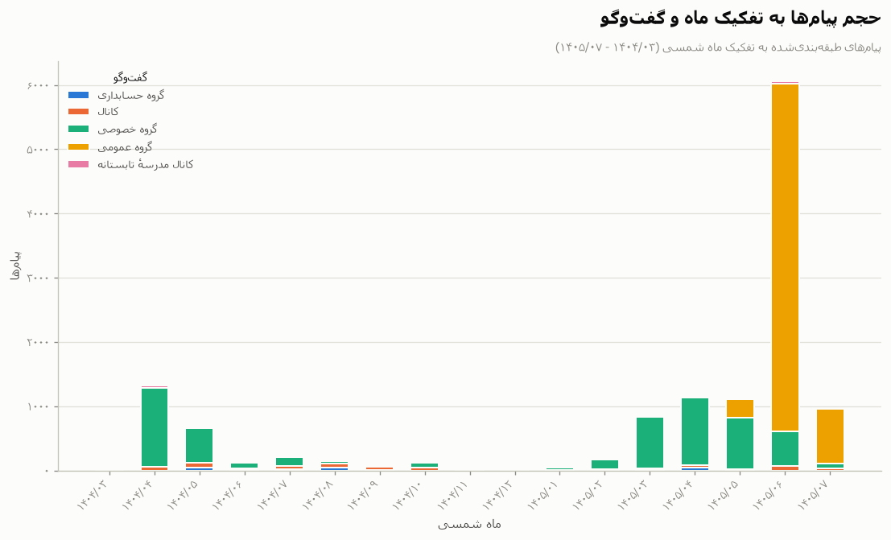
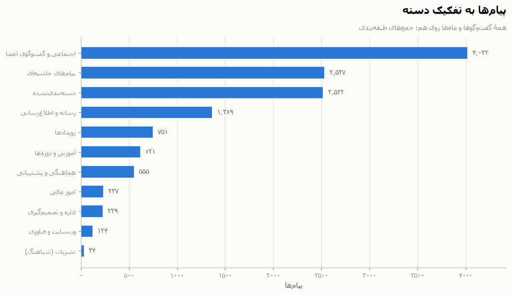
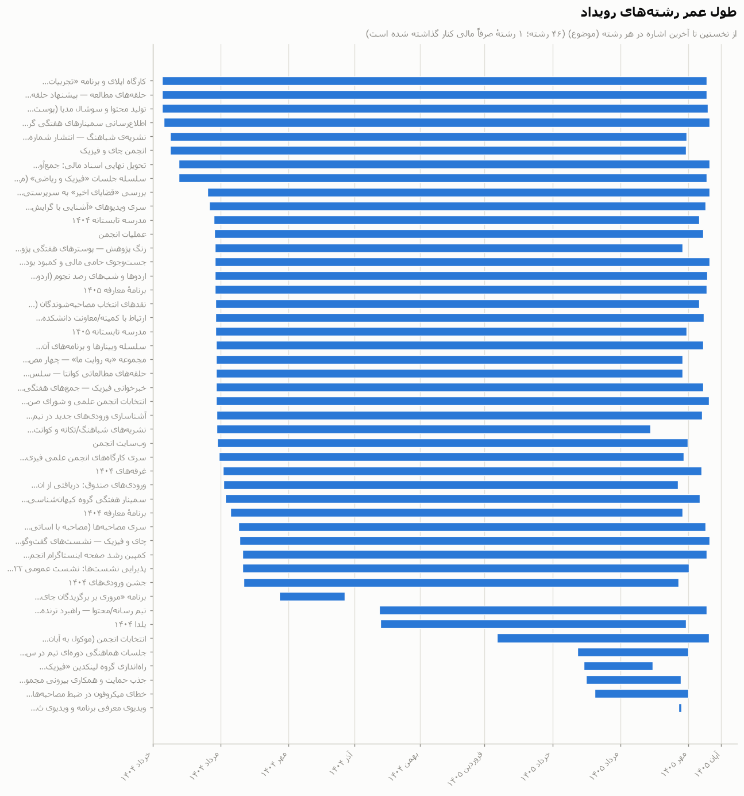
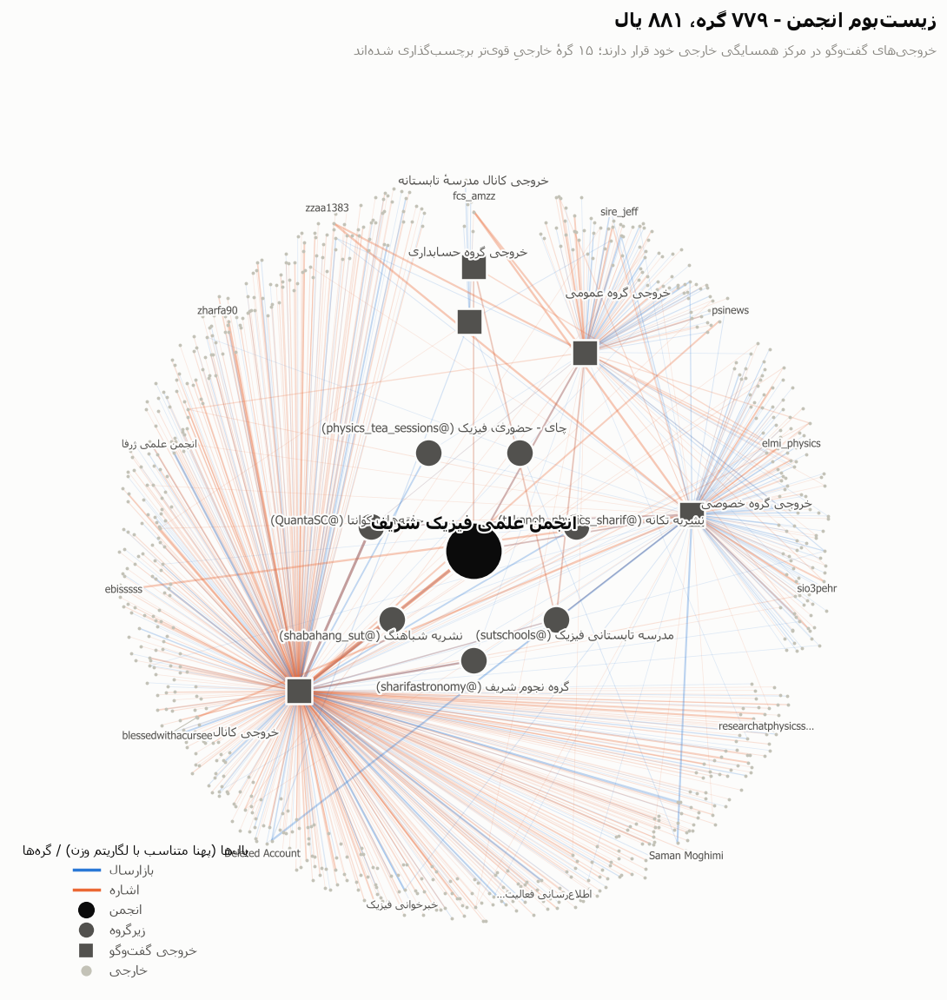
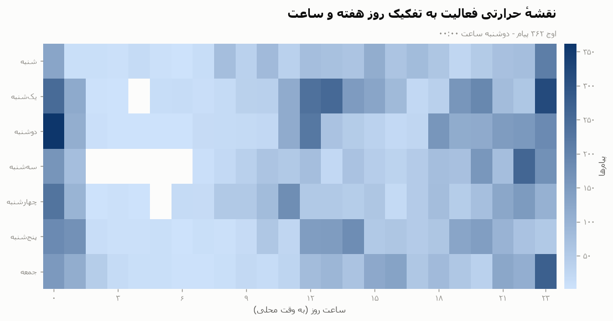
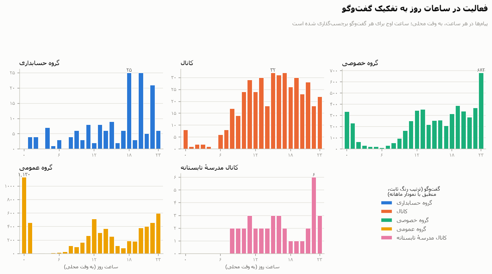

# گزارش عملکرد و فعالیت انجمن (۱۴۰۴/۰۳/۰۷ ← ۱۴۰۵/۰۷/۲۲)

بازهٔ ۲۰۲۵-۰۵-۲۸ ← ۲۰۲۶-۱۰-۱۴ (۱۴۰۴/۰۳/۰۷ ← ۱۴۰۵/۰۷/۲۲)، پنج خروجی تلگرام. این گزارش صرفاً از خروجی‌های تحلیل گردآوری شده است: `timeline.json` (۴۷ رشته (موضوع)، ۱۷ ماه جلالی، ۴۵ سازوکار)، `ecosystem.json` (۷۷۹ گره / ۸۸۱ یال)، `classified.jsonl` (۱۶٬۶۷۷ رکورد؛ ۱۲٬۰۶۶ رکورد درون بازه و غیرخدماتی)، `classification_stats.json`، `threads.json` و نمایه‌های منبعی که در اینجا به کار رفته‌اند (کانال، کانال مدرسهٔ تابستانه، دفتر کل، گزارش رسانه‌ای (docx)). نمودارها همان نمودارهای Task-11 را نمایش می‌دهند.

## ۱. خلاصهٔ مدیریتی

در طول بازهٔ تحلیل، پنج خروجی تلگرام دربردارندهٔ **۱۲٬۰۶۶ پیام درون بازه و غیرخدماتی** هستند (از مجموع ۱۶٬۶۷۷ رکورد تجزیه‌شده؛ پوشش طبقه‌بندی درون بازه ۷۹٪).

پیام‌ها به تفکیک گفت‌وگو (درون بازه، غیرخدماتی):

| گفت‌وگو | پیام‌ها | سهم |
|---|---|---|
| گروه عمومی | ۶٬۱۳۶ | ۵۰٫۹٪ |
| گروه خصوصی | ۵٬۳۰۹ | ۴۴٫۰٪ |
| کانال | ۴۲۶ | ۳٫۵٪ |
| گروه حسابداری | ۱۵۸ | ۱٫۳٪ |
| کانال مدرسهٔ تابستانه | ۳۷ | ۰٫۳٪ |

سه دستهٔ بزرگ فعالیت بر پایهٔ شمار برچسب‌ها عبارت‌اند از **اجتماعی و گفت‌وگوی اعضا** (۴٬۰۲۲)، **پیام‌های حاشیه‌ای** (۲٬۵۳۷) و **دسته‌بندی‌نشده** (۲٬۵۲۲) از مجموع ۱۳٬۰۰۱ برچسب‌گذاری (چندبرچسبی؛ نک. §۷). مرحلهٔ همبستگی **۴۷ رشته (موضوع)** را دنبال می‌کند (۴۶ رشتهٔ دارای پیام + ۱ رشتهٔ صرفاً مالی) و دفتر کل تطبیق‌شدهٔ پشتوانهٔ آن‌ها **۱۳۹٬۷۸۷٬۰۰۰ تومان دریافت در برابر ۱۲۳٬۲۶۵٬۹۹۴ تومان پرداخت** را نشان می‌دهد (خالص **+۱۶٬۵۲۱٬۰۰۶**، همهٔ ۹۶ ردیف، شامل سبد بدون تاریخ به مبلغ ۴٬۶۶۴٬۷۰۰ تومان).

پنج رشته (موضوع) اصلی بر اساس تعداد پیام‌های منتسب:

| رشته (موضوع) | عنوان | نخستین ← آخرین مشاهده | گفت‌وگوها | پیام‌ها | جمع تراکنش‌ها (تومان) |
|---|---|---|---|---|---|
| `intro-event-1405` | برنامهٔ معارفه ۱۴۰۵ | ۱۴۰۴/۰۴/۲۶ ← ۱۴۰۵/۰۷/۱۷ | ۵ | ۷۵۲ | ۵۶٬۱۸۵٬۰۰۰ |
| `final-receipt-handover-1405` | تحویل نهایی اسناد مالی: جمع‌آوری عکس همه فاک… | ۱۴۰۴/۰۳/۲۴ ← ۱۴۰۵/۰۷/۲۰ | ۵ | ۴۱۳ | — |
| `media-social-content` | تولید محتوا و سوشال مدیا (پوستر/پست/اینستا، … | ۱۴۰۴/۰۳/۰۹ ← ۱۴۰۵/۰۷/۱۸ | ۵ | ۳۸۵ | — |
| `summer-school-1404` | مدرسه تابستانه ۱۴۰۴ | ۱۴۰۴/۰۴/۲۵ ← ۱۴۰۵/۰۷/۱۰ | ۵ | ۲۳۱ | ۴۶٬۹۴۲٬۹۰۰ |
| `dept-weekly-seminars` | اطلاع‌رسانی سمینارهای هفتگی گروه‌های دانشکده… | ۱۴۰۴/۰۳/۱۰ ← ۱۴۰۵/۰۷/۲۰ | ۳ | ۲۰۸ | — |

## ۲. روایت دوره‌ها

تاریخ‌های نخستین مشاهدهٔ رشته‌ها (موضوع‌ها) و فعالیت ماهانه، بازه را به چهار دوره تقسیم می‌کنند (ماه‌های جلالی؛ بازه از ۱۴۰۴/۰۳/۰۷ = ۲۰۲۵-۰۵-۲۸ آغاز می‌شود). تاریخ‌های نخستین مشاهده از پیام‌های منتسب به دست می‌آیند و از این رو ملاحظهٔ انتساب §۷ را به ارث می‌برند.

*بخش ناقص آغاز بازه:* ماه(های) ناقص ۱۴۰۴/۰۳ شامل ۱۴ پیام و نخستین مشاهدهٔ ۸ رشته (موضوع) است (بزرگ‌ترین: `final-receipt-handover-1405`، ۴۱۳ پیام)؛ این ماه‌ها پیش از چهار دورهٔ زیر قرار دارند.

### تابستان ۱۴۰۴ (۱۴۰۴/۰۴–۱۴۰۴/۰۶)

**تابستان ۱۴۰۴** بازهٔ ۱۴۰۴/۰۴–۱۴۰۴/۰۶ جلالی را در بر می‌گیرد و **۱٬۹۶۲ پیام** در گفت‌وگوها دارد؛ پرکارترین بستر گروه خصوصی (۱٬۷۸۸ پیام) است و برچسب‌های غالب پیام‌های حاشیه‌ای (۶۳۵) و اجتماعی و گفت‌وگوی اعضا (۵۳۳) هستند. ۳۰ رشته (موضوع) نخستین بار در این دوره ظاهر می‌شوند که در رأس آن‌ها `intro-event-1405` قرار دارد (نخستین مشاهده ۲۰۲۵-۰۷-۱۷ / ۱۴۰۴/۰۴/۲۶، ۷۵۲ پیام در ۵ گفت‌وگو). ماه اوج این دوره ۱۴۰۴/۰۴ (۱٬۲۵۹ پیام) است.

| رشته (موضوع) | نخستین مشاهده | جلالی | پیام‌ها | گفت‌وگوها | آخرین مشاهده |
|---|---|---|---|---|---|
| `intro-event-1405` | ۲۰۲۵-۰۷-۱۷ | ۱۴۰۴/۰۴/۲۶ | ۷۵۲ | ۵ | ۲۰۲۶-۱۰-۰۹ |
| `summer-school-1404` | ۲۰۲۵-۰۷-۱۶ | ۱۴۰۴/۰۴/۲۵ | ۲۳۱ | ۵ | ۲۰۲۶-۱۰-۰۲ |
| `astro-trips-observing` | ۲۰۲۵-۰۷-۱۷ | ۱۴۰۴/۰۴/۲۶ | ۱۳۹ | ۵ | ۲۰۲۶-۱۰-۱۰ |
| `sponsorship-room-renovation` | ۲۰۲۵-۰۷-۱۷ | ۱۴۰۴/۰۴/۲۶ | ۱۲۳ | ۳ | ۲۰۲۶-۱۰-۱۲ |
| `orientation-videos-2025` | ۲۰۲۵-۰۷-۱۲ | ۱۴۰۴/۰۴/۲۱ | ۱۰۳ | ۳ | ۲۰۲۶-۱۰-۰۸ |

### سال تحصیلی ۱۴۰۴-۰۵ (۱۴۰۴/۰۷–۱۴۰۵/۰۳)

**سال تحصیلی ۱۴۰۴-۰۵** بازهٔ ۱۴۰۴/۰۷–۱۴۰۵/۰۳ جلالی را در بر می‌گیرد و **۱٬۴۶۷ پیام** در گفت‌وگوها دارد؛ پرکارترین بستر گروه خصوصی (۱٬۱۸۱ پیام) است و برچسب‌های غالب دسته‌بندی‌نشده (۳۶۳) و پیام‌های حاشیه‌ای (۳۴۹) هستند. ۶ رشته (موضوع) نخستین بار در این دوره ظاهر می‌شوند که در رأس آن‌ها `media-team-content-pipeline` قرار دارد (نخستین مشاهده ۲۰۲۵-۱۲-۱۴ / ۱۴۰۴/۰۹/۲۳، ۶۵ پیام در ۲ گفت‌وگو). ماه اوج این دوره ۱۴۰۵/۰۳ (۷۸۴ پیام) است.

| رشته (موضوع) | نخستین مشاهده | جلالی | پیام‌ها | گفت‌وگوها | آخرین مشاهده |
|---|---|---|---|---|---|
| `media-team-content-pipeline` | ۲۰۲۵-۱۲-۱۴ | ۱۴۰۴/۰۹/۲۳ | ۶۵ | ۲ | ۲۰۲۶-۱۰-۰۹ |
| `elections-1405` | ۲۰۲۶-۰۴-۰۱ | ۱۴۰۵/۰۱/۱۲ | ۶۱ | ۳ | ۲۰۲۶-۱۰-۱۱ |
| `weekly-coordination-meeting-21h` | ۲۰۲۶-۰۶-۱۳ | ۱۴۰۵/۰۳/۲۳ | ۱۴ | ۲ | ۲۰۲۶-۰۹-۲۲ |
| `linkedin-alumni-group` | ۲۰۲۶-۰۶-۱۹ | ۱۴۰۵/۰۳/۲۹ | ۱۰ | ۱ | ۲۰۲۶-۰۸-۲۱ |
| `yalda-1404` | ۲۰۲۵-۱۲-۱۵ | ۱۴۰۴/۰۹/۲۴ | ۹ | ۳ | ۲۰۲۶-۰۹-۲۰ |

### تابستان ۱۴۰۵ (۱۴۰۵/۰۴–۱۴۰۵/۰۶)

**تابستان ۱۴۰۵** بازهٔ ۱۴۰۵/۰۴–۱۴۰۵/۰۶ جلالی را در بر می‌گیرد و **۷٬۷۴۷ پیام** در گفت‌وگوها دارد؛ پرکارترین بستر گروه عمومی (۵٬۳۵۵ پیام) است و برچسب‌های غالب اجتماعی و گفت‌وگوی اعضا (۲٬۹۱۵) و دسته‌بندی‌نشده (۱٬۶۶۶) هستند. ۲ رشته (موضوع) نخستین بار در این دوره ظاهر می‌شوند که در رأس آن‌ها `intro-and-registration-videos` قرار دارد (نخستین مشاهده ۲۰۲۶-۰۹-۱۴ / ۱۴۰۵/۰۶/۲۳، ۱۲۶ پیام در ۱ گفت‌وگو). ماه اوج این دوره ۱۴۰۵/۰۶ (۵٬۶۳۸ پیام) است.

| رشته (موضوع) | نخستین مشاهده | جلالی | پیام‌ها | گفت‌وگوها | آخرین مشاهده |
|---|---|---|---|---|---|
| `intro-and-registration-videos` | ۲۰۲۶-۰۹-۱۴ | ۱۴۰۵/۰۶/۲۳ | ۱۲۶ | ۱ | ۲۰۲۶-۰۹-۱۶ |
| `mic-failure-voice-loss` | ۲۰۲۶-۰۶-۲۹ | ۱۴۰۵/۰۴/۰۸ | ۳ | ۲ | ۲۰۲۶-۰۹-۲۳ |

### پاییز ۱۴۰۵ (۱۴۰۵/۰۷–۱۴۰۵/۰۷)

**پاییز ۱۴۰۵** بازهٔ ۱۴۰۵/۰۷–۱۴۰۵/۰۷ جلالی را در بر می‌گیرد و **۸۷۶ پیام** در گفت‌وگوها دارد؛ پرکارترین بستر گروه عمومی (۷۸۱ پیام) است و برچسب‌های غالب اجتماعی و گفت‌وگوی اعضا (۲۶۸) و پیام‌های حاشیه‌ای (۲۰۱) هستند. هیچ رشته (موضوع) جدیدی نخستین بار در این دوره ظاهر نمی‌شود. ماه اوج این دوره ۱۴۰۵/۰۷ (۸۷۶ پیام) است.

## ۳. دسته‌های فعالیت

برچسب‌گذاری‌های ماهانه در هر دسته، تجمیع‌شده روی گفت‌وگوها (`monthly_activity`؛ پیامی با چند برچسب به ازای هر برچسب یک بار شمرده می‌شود — ۱۳٬۰۰۱ برچسب‌گذاری روی ۱۲٬۰۶۶ پیام درون بازه).

**۱۴۰۴** (ستون‌ها ماه جلالی MM هستند)

| دسته | ۰۳ | ۰۴ | ۰۵ | ۰۶ | ۰۷ | ۰۸ | ۰۹ | ۱۰ | ۱۱ | ۱۲ | جمع |
|---|---|---|---|---|---|---|---|---|---|---|---|
| اجتماعی و گفت‌وگوی اعضا | ۱ | ۳۴۳ | ۱۶۷ | ۲۳ | ۳۵ | ۱۵ | ۷ | ۲۴ | ۵ | — | **۴٬۰۲۲** |
| پیام‌های حاشیه‌ای | — | ۴۴۹ | ۱۶۹ | ۱۷ | ۵۰ | ۱۳ | ۴ | ۲۱ | ۳ | ۲ | **۲٬۵۳۷** |
| دسته‌بندی‌نشده | — | ۲۰۴ | ۱۱۲ | ۷ | ۲۹ | ۱۶ | ۶ | ۲۲ | ۳ | ۵ | **۲٬۵۲۲** |
| رسانه و اطلاع‌رسانی | ۲ | ۶۱ | ۳۷ | ۲۱ | ۱۵ | ۱۶ | ۱۳ | ۱۱ | ۲ | ۳ | **۱٬۳۶۹** |
| رویدادها | ۵ | ۱۱ | ۴۷ | ۱۶ | ۳۱ | ۴۲ | ۳۰ | ۱۶ | ۱ | — | **۷۵۱** |
| آموزش و دوره‌ها | ۹ | ۱۲۴ | ۶۴ | ۱۸ | ۱۷ | ۱۲ | ۸ | ۹ | ۱ | — | **۶۲۱** |
| هماهنگی و پشتیبانی | — | ۴۵ | ۲۱ | ۷ | ۱۳ | ۱۰ | ۳ | ۲ | ۲ | — | **۵۵۵** |
| امور مالی | ۲ | ۴۸ | ۲۸ | — | ۹ | ۱۸ | ۱ | ۱ | ۳ | ۲ | **۲۳۷** |
| اداره و تصمیم‌گیری | — | ۴ | ۷ | ۴ | ۵ | ۲ | ۱ | ۷ | ۱ | — | **۲۲۹** |
| وب‌سایت و فناوری | — | ۳۲ | ۱ | ۶ | ۱ | ۲ | ۱ | ۳ | — | — | **۱۲۴** |
| نشریات (شباهنگ) | — | — | ۳ | — | ۳ | ۱ | — | ۱ | — | — | **۳۴** |
| **همهٔ برچسب‌گذاری‌ها** | **۱۹** | **۱٬۳۲۱** | **۶۵۶** | **۱۱۹** | **۲۰۸** | **۱۴۷** | **۷۴** | **۱۱۷** | **۲۱** | **۱۲** | **۱۳٬۰۰۱** |

**۱۴۰۵** (ستون‌ها ماه جلالی MM هستند)

| دسته | ۰۱ | ۰۲ | ۰۳ | ۰۴ | ۰۵ | ۰۶ | ۰۷ | جمع |
|---|---|---|---|---|---|---|---|---|
| اجتماعی و گفت‌وگوی اعضا | ۱۷ | ۴۷ | ۱۵۵ | ۱۸۹ | ۴۰۶ | ۲٬۳۲۰ | ۲۶۸ | **۴٬۰۲۲** |
| پیام‌های حاشیه‌ای | ۴ | ۳۳ | ۲۱۹ | ۳۳۹ | ۱۷۵ | ۸۳۸ | ۲۰۱ | **۲٬۵۳۷** |
| دسته‌بندی‌نشده | ۸ | ۴۷ | ۲۲۷ | ۲۷۴ | ۲۳۱ | ۱٬۱۶۱ | ۱۷۰ | **۲٬۵۲۲** |
| رسانه و اطلاع‌رسانی | ۲ | ۱۳ | ۵۰ | ۱۱۸ | ۱۶۴ | ۷۴۰ | ۱۰۱ | **۱٬۳۶۹** |
| رویدادها | ۷ | ۲ | ۴۶ | ۴۲ | ۱۹ | ۳۶۳ | ۷۳ | **۷۵۱** |
| آموزش و دوره‌ها | — | ۷ | ۴۱ | ۳۵ | ۵۳ | ۱۹۶ | ۲۷ | **۶۲۱** |
| هماهنگی و پشتیبانی | ۱ | ۲ | ۳۰ | ۵۳ | ۳۹ | ۲۶۳ | ۶۴ | **۵۵۵** |
| امور مالی | — | ۱ | ۵ | ۱۲ | ۳ | ۹۹ | ۵ | **۲۳۷** |
| اداره و تصمیم‌گیری | ۲ | ۱۱ | ۵۱ | ۵۰ | ۱۸ | ۳۶ | ۳۰ | **۲۲۹** |
| وب‌سایت و فناوری | — | ۱ | ۴ | ۱۲ | ۳ | ۴۴ | ۱۴ | **۱۲۴** |
| نشریات (شباهنگ) | — | — | ۸ | ۱۲ | ۲ | ۴ | — | **۳۴** |
| **همهٔ برچسب‌گذاری‌ها** | **۴۱** | **۱۶۴** | **۸۳۶** | **۱٬۱۳۶** | **۱٬۱۱۳** | **۶٬۰۶۴** | **۹۵۳** | **۱۳٬۰۰۱** |

پرتعامل‌ترین رشته‌ها (موضوع‌ها) در هر دسته، بر پایهٔ **۱٬۱۸۶ پیام دارای انتساب صریح** (`event_ref` مدل زبانی؛ انتساب جنبهٔ گفت‌وگویی دارد و پیوند مستند نیست — ر.ک. §۷):

| دسته | برچسب‌گذاری‌ها | سهم | ماه اوج | دارای انتساب صریح | رشته‌های (موضوع‌های) برتر بر اساس انتساب صریح (پیام) |
|---|---|---|---|---|---|
| اجتماعی و گفت‌وگوی اعضا | ۴٬۰۲۲ | ۳۰٫۹٪ | ۱۴۰۵/۰۶ | ۵۸۹ | `intro-event-1405` (۳۶۶)، `summer-school-1404` (۷۷)، `intro-and-registration-videos` (۵۵) |
| پیام‌های حاشیه‌ای | ۲٬۵۳۷ | ۱۹٫۵٪ | ۱۴۰۵/۰۶ | ۱ | `intro-event-1405` (۱) |
| دسته‌بندی‌نشده | ۲٬۵۲۲ | ۱۹٫۴٪ | ۱۴۰۵/۰۶ | ۰ | *(هیچ پیامی با انتساب صریح)* |
| رسانه و اطلاع‌رسانی | ۱٬۳۶۹ | ۱۰٫۵٪ | ۱۴۰۵/۰۶ | ۲۰۳ | `intro-and-registration-videos` (۷۳)، `intro-event-1405` (۶۶)، `media-team-content-pipeline` (۴۱) |
| رویدادها | ۷۵۱ | ۵٫۸٪ | ۱۴۰۵/۰۶ | ۱۵۸ | `intro-event-1405` (۱۴۶)، `tea-physics-society` (۴)، `apply-workshop` (۳) |
| آموزش و دوره‌ها | ۶۲۱ | ۴٫۸٪ | ۱۴۰۵/۰۶ | ۵۸ | `summer-school-1404` (۳۰)، `summer-school-1405` (۲۱)، `calculus-study-circle` (۴) |
| هماهنگی و پشتیبانی | ۵۵۵ | ۴٫۳٪ | ۱۴۰۵/۰۶ | ۲۴۹ | `intro-event-1405` (۱۵۰)، `summer-school-1404` (۴۹)، `sponsorship-room-renovation` (۲۱) |
| امور مالی | ۲۳۷ | ۱٫۸٪ | ۱۴۰۵/۰۶ | ۴۱ | `intro-event-1405` (۱۶)، `summer-school-1404` (۱۲)، `sponsorship-room-renovation` (۱۰) |
| اداره و تصمیم‌گیری | ۲۲۹ | ۱٫۸٪ | ۱۴۰۵/۰۳ | ۱۲ | `elections-1405` (۵)، `linkedin-alumni-group` (۴)، `intro-event-1405` (۲) |
| وب‌سایت و فناوری | ۱۲۴ | ۱٫۰٪ | ۱۴۰۵/۰۶ | ۳۱ | `intro-event-1405` (۱۰)، `summer-school-1404` (۸)، `summer-school-1405` (۸) |
| نشریات (شباهنگ) | ۳۴ | ۰٫۳٪ | ۱۴۰۵/۰۴ | ۲ | `shabahang-journals-funding` (۲) |

## ۴. همبستگی میان گفت‌وگوها

همهٔ ۴۶ رشته (موضوع) دارای پیام، همراه با پراکندگی آن‌ها در هر گفت‌وگو، تأخیر اعلان و مبالغ مرتبط در دفتر کل. `Explicit` پیام‌هایی را می‌شمارد که `event_ref` مدل زبانی آن‌ها نام این رشته را آورده است؛ باقی‌ماندهٔ `Msgs` عضویت از طریق انتساب جایگزین کلیدواژه‌ای است (۲٬۷۳۴ مورد از ۳٬۹۲۰ انتساب)، بنابراین رشته‌هایی که عمدتاً بر انتساب جایگزین کلیدواژه‌ای متکی‌اند، تعداد پیام و تأخیر تقریبی دارند (§۷). `Lag` = تعداد روزها از نخستین پیام در زودترین گفت‌وگوی غیرکانالی تا نخستین پیام کانال؛ مقدار منفی یعنی اعلان کانال پیش از هماهنگی در گفت‌وگوهای دیگر بوده است.

| رشته (موضوع) | نخستین مشاهده | گفت‌وگوها | پیام‌ها | صریح | تأخیر (روز) | جمع تراکنش‌ها (تومان) |
|---|---|---|---|---|---|---|
| `intro-event-1405` | ۱۴۰۴/۰۴/۲۶ | ۵ | ۷۵۲ | ۶۶۲ | +۰ | ۵۶٬۱۸۵٬۰۰۰ |
| `final-receipt-handover-1405` | ۱۴۰۴/۰۳/۲۴ | ۵ | ۴۱۳ | ۱ | -۳۳ | — |
| `media-social-content` | ۱۴۰۴/۰۳/۰۹ | ۵ | ۳۸۵ | ۱ | -۴۸ | — |
| `summer-school-1404` | ۱۴۰۴/۰۴/۲۵ | ۵ | ۲۳۱ | ۱۶۹ | +۰ | ۴۶٬۹۴۲٬۹۰۰ |
| `dept-weekly-seminars` | ۱۴۰۴/۰۳/۱۰ | ۳ | ۲۰۸ | ۰ | -۴۸ | — |
| `physics-math-circle` | ۱۴۰۴/۰۳/۲۴ | ۵ | ۱۶۷ | ۰ | -۳۳ | — |
| `astro-trips-observing` | ۱۴۰۴/۰۴/۲۶ | ۵ | ۱۳۹ | ۰ | +۰ | — |
| `intro-and-registration-videos` | ۱۴۰۵/۰۶/۲۳ | ۱ | ۱۲۶ | ۱۲۶ | — | — |
| `sponsorship-room-renovation` | ۱۴۰۴/۰۴/۲۶ | ۳ | ۱۲۳ | ۳۵ | +۱۵۱ | — |
| `apply-workshop` | ۱۴۰۴/۰۳/۰۹ | ۳ | ۱۲۱ | ۱۱ | -۴۹ | — |
| `orientation-videos-2025` | ۱۴۰۴/۰۴/۲۱ | ۳ | ۱۰۳ | ۰ | -۱۲ | — |
| `association-website` | ۱۴۰۴/۰۴/۲۹ | ۴ | ۹۱ | ۲ | +۵ | ۳٬۰۰۰٬۰۰۰ |
| `summer-school-1405` | ۱۴۰۴/۰۴/۲۷ | ۳ | ۸۱ | ۶۳ | — | ۱۱٬۵۰۰٬۰۰۰ |
| `interview-selection-critique` | ۱۴۰۴/۰۴/۲۷ | ۴ | ۷۸ | ۰ | +۸۹ | — |
| `instagram-growth-campaign` | ۱۴۰۴/۰۵/۲۰ | ۴ | ۶۵ | ۳ | +۸۹ | — |
| `media-team-content-pipeline` | ۱۴۰۴/۰۹/۲۳ | ۲ | ۶۵ | ۶۱ | — | — |
| `interview-series` | ۱۴۰۴/۰۵/۱۷ | ۴ | ۶۲ | ۱ | +۲۳ | — |
| `elections-1405` | ۱۴۰۵/۰۱/۱۲ | ۳ | ۶۱ | ۶ | -۷۱ | — |
| `hospitality-sessions-1404` | ۱۴۰۴/۰۵/۲۰ | ۳ | ۵۷ | ۰ | — | — |
| `faculty-committee-liaison` | ۱۴۰۴/۰۴/۲۷ | ۴ | ۵۶ | ۰ | +۸۶ | — |
| `october-advisor-review` | ۱۴۰۴/۰۴/۱۹ | ۳ | ۵۱ | ۰ | -۸ | — |
| `quanta-study-circles` | ۱۴۰۴/۰۴/۲۷ | ۲ | ۵۰ | ۱۰ | — | — |
| `welcome-semester-onboarding` | ۱۴۰۴/۰۴/۲۸ | ۳ | ۵۰ | ۲ | — | — |
| `shabahang-journal` | ۱۴۰۴/۰۳/۱۶ | ۴ | ۳۶ | ۰ | -۴۲ | — |
| `tea-physics-society` | ۱۴۰۴/۰۳/۱۶ | ۳ | ۳۶ | ۱۳ | -۴۱ | ۲٬۴۹۲٬۸۵۰ |
| `covid-webinar-series` | ۱۴۰۴/۰۴/۲۷ | ۳ | ۳۶ | ۰ | +۴ | — |
| `physics-newsreading` | ۱۴۰۴/۰۴/۲۷ | ۴ | ۲۹ | ۰ | +۴۲۴ | — |
| `association-elections` | ۱۴۰۴/۰۴/۲۷ | ۳ | ۲۷ | ۰ | +۱۶۴ | — |
| `cosmology-weekly-seminar` | ۱۴۰۴/۰۵/۰۵ | ۳ | ۲۷ | ۰ | -۱۵ | — |
| `calculus-study-circle` | ۱۴۰۴/۰۳/۰۹ | ۳ | ۲۶ | ۴ | -۲۲۳ | — |
| `association-operations` | ۱۴۰۴/۰۴/۲۵ | ۴ | ۲۴ | ۰ | -۱۰۳ | ۳۷٬۰۹۷٬۷۰۰ |
| `workshop-series` | ۱۴۰۴/۰۴/۳۰ | ۳ | ۱۵ | ۰ | +۱۶۲ | — |
| `booths-1404` | ۱۴۰۴/۰۵/۰۲ | ۴ | ۱۴ | ۰ | +۴۵ | ۱٬۹۹۵٬۰۰۰ |
| `weekly-coordination-meeting-21h` | ۱۴۰۵/۰۳/۲۳ | ۲ | ۱۴ | ۴ | — | — |
| `beh-royat-ma-interview-series` | ۱۴۰۴/۰۴/۲۷ | ۳ | ۱۳ | ۰ | +۳ | — |
| `tea-and-physics` | ۱۴۰۴/۰۵/۱۸ | ۳ | ۱۳ | ۰ | +۳۱۹ | — |
| `linkedin-alumni-group` | ۱۴۰۵/۰۳/۲۹ | ۱ | ۱۰ | ۹ | — | — |
| `research-bell-photos` | ۱۴۰۴/۰۴/۲۶ | ۳ | ۹ | ۰ | +۱۱۷ | — |
| `intro-event-1404` | ۱۴۰۴/۰۵/۰۹ | ۴ | ۹ | ۱ | +۳۶ | ۸٬۰۷۵٬۰۰۰ |
| `yalda-1404` | ۱۴۰۴/۰۹/۲۴ | ۳ | ۹ | ۰ | -۱۵۳ | ۳۷٬۲۲۵٬۴۲۴ |
| `kava-external-partnership` | ۱۴۰۵/۰۳/۳۱ | ۲ | ۹ | ۰ | — | — |
| `shabahang-journals-funding` | ۱۴۰۴/۰۴/۲۸ | ۲ | ۸ | ۲ | +۱۵ | — |
| `inflows-donations-legacy-funds` | ۱۴۰۴/۰۵/۰۳ | ۳ | ۷ | ۰ | +۳۵۱ | — |
| `freshman-party-1404` | ۱۴۰۴/۰۵/۲۱ | ۳ | ۶ | ۰ | — | ۶٬۰۷۴٬۰۰۰ |
| `nobel-review-series` | ۱۴۰۴/۰۶/۲۳ | ۲ | ۵ | ۰ | -۱۹ | — |
| `mic-failure-voice-loss` | ۱۴۰۵/۰۴/۰۸ | ۲ | ۳ | ۰ | — | — |

**پول بدون پیام منطبق — شکاف پوشش:** `professors-assembly-mehr` (مجمع اساتید مهر) دارای ۴ ردیف در دفتر کل است (۲٬۶۹۴٬۷۵۰ تومان ناخالص: دریافت‌ها ۵۰۰٬۰۰۰، پرداخت‌ها ۲٬۱۹۴٬۷۵۰؛ TX0019، TX0020، TX0024، TX0025) اما هیچ پیامی با تطبیق کلیدواژه‌ای یا مدل زبانی ندارد؛ از این رو صرفاً به‌عنوان مورد مالی و با مقادیر تهی برای نخستین/آخرین/تأخیر نگه داشته شده است. TX0025 در دفتر کل وضعیت *تکراری* دارد و مبلغ آن، جمع ناخالص را بیش از واقع نشان می‌دهد.

سه مطالعهٔ موردی زیر، رشته‌هایی (موضوع‌هایی) هستند که بیشترین تعداد گفت‌وگو را در بر می‌گیرند (هر پنج گفت‌وگو؛ در صورت تساوی، بر اساس حجم تراکنش‌های مرتبط و سپس تعداد پیام).

### مطالعهٔ موردی: `intro-event-1405` — برنامهٔ معارفه ۱۴۰۵

۷۵۲ پیام منتسب در ۵ گفت‌وگو، ۲۰۲۵-۰۷-۱۷ ← ۲۰۲۶-۱۰-۰۹ (۱۴۰۴/۰۴/۲۶ ← ۱۴۰۵/۰۷/۱۷)؛ تأخیر اعلان **+۰ روز** (نخستین پیام کانال ۱۴۰۴/۰۴/۲۶). انتساب صریح: ۶۶۲ از ۷۵۲ پیام (۸۸٫۰٪)؛ ۹۰ پیام باقی‌مانده عضویت‌های انتساب جایگزین کلیدواژه‌ای هستند.
منابع مالی دفتر کل در پشتوانهٔ این رشته (موضوع): ۵۶٬۱۸۵٬۰۰۰ تومان ناخالص در ۴ تراکنش (دریافت‌ها: ۵۰٬۲۳۵٬۰۰۰ / پرداخت‌ها: ۵٬۹۵۰٬۰۰۰).

| مرحله | تاریخ | مرجع | شواهد |
|---|---|---|---|
| برنامه‌ریزی — نخستین انتساب صریح | ۱۴۰۵/۰۳/۰۴ ۲۱:۴۱ | private_group#message9715 | [رسانه: پیام صوتی] |
| اعلان — نخستین پست کانال (۱۱ پیام) | ۱۴۰۴/۰۴/۲۶ ۲۱:۳۱ | *(نخستین پیام گفت‌وگو، تطبیق کلیدواژه‌ای)* | نخستین پیام گفت‌وگو ۱۴۰۴/۰۴/۲۶؛ نخستین ارجاع صریح به channel#message3497 ۱۴۰۵/۰۶/۳۱ |
| کار — نخستین پیام در کانال مدرسهٔ تابستانه (۴ پیام) | ۱۴۰۴/۰۴/۲۷ ۱۵:۵۸ | *(نخستین پیام گفت‌وگو، تطبیق کلیدواژه‌ای)* | نخستین پیام در این گفت‌وگو |
| کار — نخستین پیام در گروه خصوصی (۴۶ پیام) | ۱۴۰۴/۰۴/۲۹ ۰۰:۰۰ | *(نخستین پیام گفت‌وگو، تطبیق کلیدواژه‌ای)* | نخستین پیام گفت‌وگو ۱۴۰۴/۰۴/۲۹؛ نخستین ارجاع صریح به private_group#message9715 ۱۴۰۵/۰۳/۰۴ |
| کار — نخستین پیام در گروه حسابداری (۱ پیام) | ۱۴۰۴/۰۷/۰۵ ۱۱:۴۳ | *(نخستین پیام گفت‌وگو، تطبیق کلیدواژه‌ای)* | نخستین پیام در این گفت‌وگو |
| اجرا — پرترافیک‌ترین گفت‌وگو گروه عمومی (۶۹۰ پیام) | ۱۴۰۵/۰۵/۲۱ ۱۵:۳۴ | *(نخستین پیام گفت‌وگو، تطبیق کلیدواژه‌ای)* | نخستین پیام گفت‌وگو ۱۴۰۵/۰۵/۲۱؛ نخستین ارجاع صریح به public_group#message678 ۱۴۰۵/۰۶/۱۳ |
| تصمیم‌های بازهٔ اجرا | ۱۴۰۵/۰۶/۲۵، ۱۴۰۵/۰۶/۲۶، ۱۴۰۵/۰۶/۲۸، ۱۴۰۵/۰۶/۲۹، ۱۴۰۵/۰۶/۳۱ | ۵ تصمیم تاریخ‌دار | پیام‌هایی از این رشته (موضوع) که با is_decision علامت‌گذاری شده‌اند |
| پرداخت — TX0088 (پرداخت) | ۱۴۰۵/۰۷ | *(ردیف دفتر کل، بدون ارجاع به پیام)* | ۹۵۰٬۰۰۰ تومان، ملزومات، تأییدشده |
| پرداخت — TX0093 (دریافت) | ۱۴۰۵/۰۷ | *(ردیف دفتر کل، بدون ارجاع به پیام)* | ۲۳٬۰۰۰٬۰۰۰ تومان، رویدادها، تأییدشده |
| پرداخت — TX0094 (دریافت) | ۱۴۰۵/۰۷ | *(ردیف دفتر کل، بدون ارجاع به پیام)* | ۲۷٬۲۳۵٬۰۰۰ تومان، رویدادها، صرفاً گزارش تجمیعی |
| پرداخت — TX0095 (پرداخت) | ۱۴۰۵/۰۷ | *(ردیف دفتر کل، بدون ارجاع به پیام)* | ۵٬۰۰۰٬۰۰۰ تومان، رویدادها، تأییدشده |

بستر اجرا `public_group` است — ۶۹۰ پیام از ۷۵۲ پیام این رشته (موضوع) بین ۱۴۰۵/۰۵/۲۱ و ۱۴۰۵/۰۷/۱۳.

فهرست رشته‌ها این رشته (موضوع) را به گزارش رسانه‌ای (docx) پیوند می‌دهد (`docx` در میان گفت‌وگوهای آن فهرست شده است)؛ شاخص‌های کارزار متناظر شهریور–مهر ۱۴۰۵ در §۵ نقل شده‌اند.

### مطالعهٔ موردی: `summer-school-1404` — مدرسه تابستانه ۱۴۰۴

۲۳۱ پیام منتسب در ۵ گفت‌وگو، ۲۰۲۵-۰۷-۱۶ ← ۲۰۲۶-۱۰-۰۲ (۱۴۰۴/۰۴/۲۵ ← ۱۴۰۵/۰۷/۱۰)؛ تأخیر اعلان **+۰ روز** (نخستین پیام کانال ۱۴۰۴/۰۴/۲۵). انتساب صریح: ۱۶۹ از ۲۳۱ پیام (۷۳٫۲٪)؛ ۶۲ پیام باقی‌مانده عضویت‌های انتساب جایگزین کلیدواژه‌ای هستند.
منابع مالی دفتر کل در پشتوانهٔ این رشته (موضوع): ۴۶٬۹۴۲٬۹۰۰ تومان ناخالص در ۱۲ تراکنش (دریافت‌ها: ۳۳٬۶۴۲٬۰۰۰ / پرداخت‌ها: ۱۳٬۳۰۰٬۹۰۰).

| مرحله | تاریخ | مرجع | شواهد |
|---|---|---|---|
| برنامه‌ریزی — نخستین انتساب صریح | ۱۴۰۴/۰۴/۲۶ ۱۶:۲۰ | private_group#message829 | من دارم با ارمیا می‌چینم تا ۸ بده سرفصل و تایمشو |
| اعلان — نخستین پست کانال (۳ پیام) | ۱۴۰۴/۰۴/۲۵ ۱۹:۱۹ | *(نخستین پیام گفت‌وگو، تطبیق کلیدواژه‌ای)* | نخستین پیام در این گفت‌وگو |
| اجرا — پرترافیک‌ترین گفت‌وگو گروه خصوصی (۲۰۰ پیام) | ۱۴۰۴/۰۴/۲۶ ۱۶:۲۰ | private_group#message829 | من دارم با ارمیا می‌چینم تا ۸ بده سرفصل و تایمشو |
| کار — نخستین پیام در کانال مدرسهٔ تابستانه (۴ پیام) | ۱۴۰۴/۰۴/۲۶ ۲۱:۴۹ | summerschool_channel#message5 | دوستان نازنین داخل کامنت سوال هاتون رو مطرح کنید اگر چیزی از قلم افتاد… |
| کار — نخستین پیام در گروه حسابداری (۱۰ پیام) | ۱۴۰۴/۰۵/۰۲ ۲۰:۴۷ | accounting_group#message10 | ۳۴۸۰ جو |
| کار — نخستین پیام در گروه عمومی (۱۴ پیام) | ۱۴۰۵/۰۵/۲۱ ۱۷:۵۵ | *(نخستین پیام گفت‌وگو، تطبیق کلیدواژه‌ای)* | نخستین پیام در این گفت‌وگو |
| تصمیم‌های بازهٔ اجرا | ۱۴۰۴/۰۴/۲۷، ۱۴۰۴/۰۴/۲۸، ۱۴۰۴/۰۴/۲۹، ۱۴۰۴/۰۴/۳۰، ۱۴۰۴/۰۵/۰۱، ۱۴۰۴/۰۵/۰۷، ۱۴۰۴/۰۵/۲۲، ۱۴۰۴/۰۷/۰۱ | ۸ تصمیم تاریخ‌دار | پیام‌هایی از این رشته (موضوع) که با is_decision علامت‌گذاری شده‌اند |
| پرداخت — TX0001 (دریافت) | ۱۴۰۴/۰۵ | accounting_group#message6، accounting_group#message7، accounting_group#message8 | ۳۳٬۶۴۲٬۰۰۰ تومان، شهریه دوره‌ها، تأییدشده |
| پرداخت — TX0002 (پرداخت) | ۱۴۰۴/۰۵ | accounting_group#message25، accounting_group#message12 | ۳٬۰۰۰٬۰۰۰ تومان، تدریس، تأییدشده |
| پرداخت — TX0003 (پرداخت) | ۱۴۰۴/۰۵ | accounting_group#message26، accounting_group#message10 | ۳٬۵۰۰٬۰۰۰ تومان، تدریس، تأییدشده |
| پرداخت — TX0004 (پرداخت) | ۱۴۰۴/۰۵ | accounting_group#message27، accounting_group#message28، accounting_group#message13 | ۳٬۷۰۰٬۰۰۰ تومان، تدریس، تأییدشده |
| پرداخت — TX0005 (پرداخت) | ۱۴۰۴/۰۵ | accounting_group#message29 | ۵۰۰٬۰۰۰ تومان، تدریس، تأییدشده |
| پرداخت — TX0006 (پرداخت) | ۱۴۰۴/۰۵ | accounting_group#message30 | ۶۰۰٬۰۰۰ تومان، تدریس، تأییدشده |
| پرداخت — TX0007 (پرداخت) | ۱۴۰۴/۰۵ | accounting_group#message31، accounting_group#message32، accounting_group#message33، accounting_group#message34 | ۶۰۰٬۰۰۰ تومان، تدریس، تأییدشده |
| پرداخت — TX0008 (پرداخت) | ۱۴۰۴/۰۵ | accounting_group#message32 | ۹۰۰ تومان، کارمزدهای بانکی، تأییدشده |
| پرداخت — TX0009 (پرداخت) | ۱۴۰۴/۰۴ | accounting_group#message43، accounting_group#message44، accounting_group#message45، accounting_group#message46 | ۴۰۰٬۰۰۰ تومان، تبلیغات، تأییدشده |
| پرداخت — TX0010 (پرداخت) | ۱۴۰۴/۰۵ | accounting_group#message57 | ۴۰۰٬۰۰۰ تومان، تبلیغات، نیازمند بررسی |
| پرداخت — TX0011 (پرداخت) | ۱۴۰۴/۰۵ | accounting_group#message42 | ۳۰۰٬۰۰۰ تومان، تدریس، تأییدشده |
| پرداخت — TX0012 (پرداخت) | ۱۴۰۴/۰۵ | accounting_group#message47 | ۳۰۰٬۰۰۰ تومان، تدریس، تأییدشده |

بستر اجرا `private_group` است — ۲۰۰ پیام از ۲۳۱ پیام این رشته (موضوع) بین ۱۴۰۴/۰۴/۲۶ و ۱۴۰۵/۰۶/۰۵.

### مطالعهٔ موردی: `final-receipt-handover-1405` — تحویل نهایی اسناد مالی: جمع‌آوری عکس همه فاکتورها/رسیدها و ق…

۴۱۳ پیام منتسب در ۵ گفت‌وگو، ۲۰۲۵-۰۶-۱۴ ← ۲۰۲۶-۱۰-۱۲ (۱۴۰۴/۰۳/۲۴ ← ۱۴۰۵/۰۷/۲۰)؛ تأخیر اعلان **-۳۳ روز** (نخستین پیام کانال ۱۴۰۴/۰۳/۲۴). انتساب صریح: ۱ از ۴۱۳ پیام (۰٫۲٪)؛ ۴۱۲ پیام باقی‌مانده عضویت‌های انتساب جایگزین کلیدواژه‌ای هستند — این رشته (موضوع) عمدتاً بر انتساب جایگزین کلیدواژه‌ای متکی است، بنابراین شمار پیام‌ها و تأخیر آن تقریبی است (§۷).
هیچ تراکنشی در دفتر کل به این رشته (موضوع) پیوند ندارد (این رشته خودِ جریان کاری گردآوری رسیدهاست، نه یک پروژهٔ هزینه‌کرد).

| مرحله | تاریخ | مرجع | شواهد |
|---|---|---|---|
| برنامه‌ریزی — نخستین انتساب صریح | ۱۴۰۵/۰۴/۰۶ ۱۵:۳۶ | accounting_group#message137 | و اینکه برای فردا عصر و پسفردا عصر یا حتی ۳شنبه عصر تایم های خالیت رو … |
| اعلان — نخستین پست کانال (۴۳ پیام) | ۱۴۰۴/۰۳/۲۴ ۱۲:۰۰ | *(نخستین پیام گفت‌وگو، تطبیق کلیدواژه‌ای)* | نخستین پیام در این گفت‌وگو |
| اجرا — پرترافیک‌ترین گفت‌وگو گروه خصوصی (۱۹۴ پیام) | ۱۴۰۴/۰۴/۲۷ ۰۰:۵۴ | *(نخستین پیام گفت‌وگو، تطبیق کلیدواژه‌ای)* | نخستین پیام در این گفت‌وگو |
| کار — نخستین پیام در کانال مدرسهٔ تابستانه (۲ پیام) | ۱۴۰۴/۰۴/۲۷ ۱۶:۴۱ | *(نخستین پیام گفت‌وگو، تطبیق کلیدواژه‌ای)* | نخستین پیام در این گفت‌وگو |
| کار — نخستین پیام در گروه حسابداری (۱۰ پیام) | ۱۴۰۴/۰۵/۰۳ ۱۵:۵۳ | *(نخستین پیام گفت‌وگو، تطبیق کلیدواژه‌ای)* | نخستین پیام گفت‌وگو ۱۴۰۴/۰۵/۰۳؛ نخستین ارجاع صریح به accounting_group#message137 ۱۴۰۵/۰۴/۰۶ |
| کار — نخستین پیام در گروه عمومی (۱۶۴ پیام) | ۱۴۰۵/۰۵/۲۱ ۱۵:۴۲ | *(نخستین پیام گفت‌وگو، تطبیق کلیدواژه‌ای)* | نخستین پیام در این گفت‌وگو |

بستر اجرا `private_group` است — ۱۹۴ پیام از ۴۱۳ پیام این رشته (موضوع) بین ۱۴۰۴/۰۴/۲۷ و ۱۴۰۵/۰۷/۱۴.

## ۵. نقشهٔ زیست‌بوم

`ecosystem.json` شامل **۷۷۹ گره / ۸۸۱ یال** است (۸ نهاد پایه، ۵ خروجی گفت‌وگو، ۷۶۶ نهاد بیرونی). اعتبارسنجی نهادهای پایه (یالی با وزن ≥ ۳ به سوی نهاد پایه، آن را مستند می‌کند):

| نهاد پایه | برچسب | وضعیت | وزن بازارسال ورودی | وزن اشارهٔ ورودی |
|---|---|---|---|---|
| association | انجمن علمی فیزیک شریف | مستند | ۴۸ | ۱٬۸۶۸ |
| physics_tea | چای فیزیک (@physics_tea_sessions) | مستند | ۲۲ | — |
| tea_chat | چای - حضوری | تأییدنشده | — | — |
| shabahang_sut | نشریه شباهنگ (@shabahang_sut) | مستند | ۳۲ | ۳۳ |
| sharifastronomy | گروه نجوم شریف (@sharifastronomy) | مستند | ۵۱ | ۵۲ |
| takaneh | نشریه تکانه (@takaneh_physics_sharif) | مستند | ۲۳ | — |
| sutschools | مدرسه تابستانی فیزیک (@sutschools) | مستند | ۱۶ | ۶۱ |
| quantasc | حلقه‌های کوانتا (@QuantaSC) | مستند | ۱۸۴ | ۲۵۲ |

**ملاحظهٔ نهاد پایهٔ تأییدنشده:** `tea_chat` = چای - حضوری در خروجی‌ها هیچ یال بازارسال یا اشاره‌ای ندارد — گردهمایی‌ای حضوری بدون ردپای دیجیتال — بنابراین همهٔ گزاره‌های گرافی این گزارش تنها بر پایهٔ ۷ نهاد پایهٔ مستند بیان شده است.

مبداهای بیرونی برتر بر اساس وزن بازارسال (بازارسال‌ها به پنج گفت‌وگو؛ مجموعاً ۱٬۲۷۳ وزن بازارسال):

| # | مبدأ بیرونی | وزن بازارسال | سهم از بازارسال‌ها |
|---|---|---|---|
| ۱ | انجمن علمی ژرفا | ۶۱ | ۴٫۸٪ |
| ۲ | Deleted Account | ۴۵ | ۳٫۵٪ |
| ۳ | خبرخوانی فیزیک | ۴۲ | ۳٫۳٪ |
| ۴ | اطلاع‌رسانی فعالیت‌های پژوهشی دانشکده‌ی فیزیک | ۳۷ | ۲٫۹٪ |
| ۵ | Saman Moghimi | ۳۶ | ۲٫۸٪ |
| ۶ | Alireza Jafari | ۲۶ | ۲٫۰٪ |
| ۷ | Za.Am | ۲۴ | ۱٫۹٪ |
| ۸ | Quantum Information Science @ Sharif University of Technology | ۲۳ | ۱٫۸٪ |
| ۹ | روزنامه شریف | SharifDaily | ۲۰ | ۱٫۶٪ |
| ۱۰ | مرکز پژوهشی فیزیک انرژی بالا | ۱۹ | ۱٫۵٪ |

**انجمن در نقش بازپخش‌کننده عمل می‌کند.** کانال آن هم بلندگو است و هم نقطهٔ توزیع مجدد: شناسهٔ انجمن **۱٬۸۶۸ وزن اشاره** را به نهاد پایهٔ انجمن متصل می‌کند (پس از ادغام نام‌های مستعار؛ ۱٬۷۹۳ مورد از آن‌ها شناسهٔ امضای پست‌های خود کانال است)، این کانال از سال ۲۰۱۸ خلاصه‌های سمینار هفتگی دانشکده را بازپخش کرده است — **۵۹۷ پست کانال در کل دوره** (نقاط مرجع ۱۳۹۷/۰۱/۲۵ ← ۱۴۰۴/۰۲/۰۴، خارج از بازهٔ تحلیل) — و **کوانتا (حلقه‌های مطالعاتی QuantaSC) ۲۲٫۵٪ از وزن بازارسال کانال را به خود اختصاص می‌دهد** (۱۸۴ از ۸۱۶)، افزون بر ۲۵۲ وزن اشاره. بدین ترتیب قوی‌ترین همکاری زیرگروهی در گراف، شبکهٔ حلقه‌های مطالعاتی منشعب از خود انجمن است.

### گزارش رسانه‌ای (docx) — شاخص‌های عین متن (نقل‌شده همراه با برچسب‌های دوره)

`گزارش عملکرد رسانه‌ای انجمن علمی فیزیک — بررسی روند تولید محتوا، اطلاع‌رسانی و دستاوردهای رویداد معرفی رشته فیزیک` — ۵۵ بند / ۲۵ ردیف جدول؛ دوره‌های پوشش‌داده‌شده: شهریور ۱۴۰۵؛ مهر ۱۴۰۵؛ ۱۲ سپتامبر تا ۱۱ اکتبر (۳۰ روز) = ۱۴۰۵/۰۶/۲۱ تا ۱۴۰۵/۰۷/۱۹. همهٔ ۳۸ شاخص به‌صورت عین متن:

| شاخص | برچسب | عین عبارت | مقدار | دوره |
|---|---|---|---|---|
| m01 | مجموع بازدید محتوا | ۷۲۶٬۵۲۷ | ۷۲۶٬۵۲۷ | ۱۲ سپتامبر تا ۱۱ اکتبر (۳۰ روز) = شهریور/مهر… |
| m02 | تعداد بینندگان گزارش‌شده | ۲۷۹٬۹۲۹ | ۲۷۹٬۹۲۹ | ۱۲ سپتامبر تا ۱۱ اکتبر (۳۰ روز) |
| m03 | رشد خالص دنبال‌کنندگان | ۶٬۰۲۹ نفر | ۶٬۰۲۹ | ۱۲ سپتامبر تا ۱۱ اکتبر (۳۰ روز) |
| m04 | دنبال‌کنندگان جدید (نمایش گردشده داشبورد… | حدود ۶٬۳۰۰ نفر (۶٫۳ هزار) | ۶٬۳۰۰ | ۱۲ سپتامبر تا ۱۱ اکتبر (۳۰ روز) |
| m05 | نسبت بازدید به بیننده | حدود ۲٫۶۰ | ۲٫۶ | بازه ۳۰روزه |
| m06 | سهم بازدید غیردنبال‌کنندگان | ۸۹٫۸٪ | ۸۹٫۸ | بازه ۳۰روزه |
| m07 | سهم بازدید دنبال‌کنندگان | ۱۰٫۲٪ | ۱۰٫۲ | بازه ۳۰روزه |
| m08 | تعداد محتوای منتشرشده | ۲۰ مورد | ۲۰ | بازه ۳۰روزه |
| m09 | بازدید ریلز | ۶۴۴٬۰۰۰ (حدود ۶۴۴ هزار) | ۶۴۴٬۰۰۰ | بازه ۳۰روزه |
| m10 | سهم ریلز از کل بازدیدهای دقیق | ۸۸٫۶۴٪ | ۸۸٫۶۴ | بازه ۳۰روزه |
| m11 | بازدید پست | ۶۰٬۰۰۰ (حدود ۶۰ هزار) | ۶۰٬۰۰۰ | بازه ۳۰روزه |
| m12 | سهم پست | ۸٫۲۶٪ | ۸٫۲۶ | بازه ۳۰روزه |
| m13 | بازدید استوری | ۲۱٬۰۰۰ (حدود ۲۱ هزار) | ۲۱٬۰۰۰ | بازه ۳۰روزه |
| m14 | سهم استوری | ۲٫۸۹٪ | ۲٫۸۹ | بازه ۳۰روزه |
| m15 | بازدید ویدیوی زنده | صفر | — | بازه ۳۰روزه |
| m16 | مصاحبه اول در فهرست پربازدیدها | ۲۰۱٬۰۰۰ (۲۰۱K) | ۲۰۱٬۰۰۰ | بازه ۳۰روزه |
| m17 | مصاحبه دوم | ۱۴۲٬۰۰۰ (۱۴۲K) | ۱۴۲٬۰۰۰ | بازه ۳۰روزه |
| m18 | مصاحبه سوم | ۱۱۶٬۰۰۰ (۱۱۶K) | ۱۱۶٬۰۰۰ | بازه ۳۰روزه |
| m19 | مصاحبه چهارم | ۷۱٬۰۰۰ (۷۱K) | ۷۱٬۰۰۰ | بازه ۳۰روزه |
| m20 | مجموع چهار مصاحبه پربازدید | ۵۳۰٬۰۰۰ (حدود ۵۳۰ هزار) | ۵۳۰٬۰۰۰ | بازه ۳۰روزه |
| m21 | سهم مصاحبه‌های پربازدید از کل بازدیدهای … | حدود ۷۲٫۹۵٪ | ۷۲٫۹۵ | بازه ۳۰روزه |
| m22 | اوج روزانه بازدید (نیمه نخست دوره) | نزدیک به خط ۱۳۷ هزار بازدید | ۱۳۷٬۰۰۰ | نیمه نخست بازه ۳۰روزه؛ تاریخ دقیق در تصویر د… |
| m23 | دنبال‌کنندگان صفحه پیش از دوره | حدود ۱۰۰ نفر | ۱۰۰ | پیش از شهریور/مهر ۱۴۰۵ |
| m24 | دنبال‌کنندگان صفحه پس از دوره | بیش از ۶ هزار نفر | ۶٬۰۰۰ | پایان بازه ۱۱ اکتبر ۱۴۰۵ |
| m25 | ایده‌پردازی و فیلم‌برداری چهار مصاحبه | ۴ تا ۸ ساعت | ۴–۸ | دوره تولید محتوا (حدود یک هفته پیش از رویداد… |
| m26 | تدوین چهار مصاحبه | ۲۰ ساعت | ۲۰ | دوره تولید محتوا |
| m27 | تدوین ویدیوی معرفی برنامه | ۵ ساعت | ۵ | دوره تولید محتوا |
| m28 | تدوین ویدیوی ثبت‌نام | ۵ ساعت | ۵ | دوره تولید محتوا |
| m29 | مجموع زمان قابل برآورد تولید | ۳۴ تا ۳۸ ساعت | ۳۴–۳۸ | کل دوره تولید شش ویدیوی اصلی |
| m30 | زمان ایده‌پردازی و فیلم‌برداری هر مصاحبه | حدود یک تا دو ساعت | ۱–۲ | دوره تولید محتوا |
| m31 | تدوین و آماده‌سازی هر یک از شش ویدیوی اص… | حدود پنج ساعت | ۵ | دوره تولید محتوا |
| m32 | تعداد ویدیوهای اصلی | شش ویدیوی اصلی | ۶ | دوره رویداد |
| m33 | تعداد مصاحبه‌های مجموعه «به روایت ما» | چهار مصاحبه | ۴ | دوره رویداد |
| m34 | ظرفیت اولیه رویداد | ۳۰ نفر | ۳۰ | رویداد معرفی رشته فیزیک (مهر ۱۴۰۵) |
| m35 | ظرفیت حضوری نهایی رویداد | ۶۰ نفر | ۶۰ | رویداد معرفی رشته فیزیک (مهر ۱۴۰۵) |
| m36 | طول بازه گزارش عملکرد | ۳۰ روز (بازه ۳۰روزه) | ۳۰ | ۱۲ سپتامبر تا ۱۱ اکتبر |
| m37 | فاصله شروع فعالیت رسانه‌ای تا رویداد | حدود دو هفته پیش از رویداد | ۲ | پیش از رویداد معرفی رشته فیزیک |
| m38 | پنجره فیلم‌برداری و تولید فشرده محتوا | حدود یک هفته پیش از رویداد ... در یک هفته فشرده | ۱ | پیش از رویداد معرفی رشته فیزیک |

ملاحظه‌های خود سند (ادعاها، به نقل عین عبارت):

- رشد دنبال‌کنندگان و توزیع محتوا نشان داد محتوای علمی-دانشگاهی با روایت انسانی هم با هویت دانشکده سازگار است و هم جذاب (para-25).
- ۸۹٫۸٪ بازدیدها از غیردنبال‌کنندگان بوده؛ درصدها سهم بازدید هستند نه افراد یکتا (para-17).
- بدون داده‌های ثبت‌نام نمی‌توان سهم مستقیم هر ویدیو در تصمیم مخاطبان را محاسبه کرد (para-27, para-45).
- در صفحات دانشگاه‌های دیگر محتواهایی با ساختار مشابه دیده شد؛ الگوبرداری قطعی اثبات‌شدنی نیست (para-33).
- نظرسنجی ساختاریافته رضایت در دست نیست، بنابراین درصد رضایت قابل گزارش نیست (para-35).
- دعوت از دانشجویان زن برای مصاحبه انجام شد اما موافقت نشد؛ مصاحبه‌ای با حضور آنان منتشر نشد (para-41).
- پیشنهادهای تیم: آغاز زودتر پیش‌تولید، ثبت منظم آمار مستقل هر محتوا، کنترل تجهیزات صوتی، نگهداری فایل پشتیبان (para-47).

در هیچ جای گزارش رسانه‌ای (docx) مبلغی به تومان نیامده است — تنها حساب هزینهٔ آن برآورد ۳۴–۳۸ ساعت تولید (m29) است؛ بنابراین جنبهٔ مالی همین کارزار به‌طور کامل بر مستندات دفتر کل در §۴ استوار است.

## ۶. الگوهای ماهانه × ساعتی (سازوکارهای دانشگاه)

`mechanics` شامل ۴۵ الگوی تکرارشونده است (۸ نوبت ثابت رویداد، ۲۸ اوج روز هفته، ۹ ساعت مرتبط با دفتر کل؛ فقط n ≥ ۵).

### نوبت‌های ثابت رویدادها

| رشته (موضوع) | زمان شروع غالب (مُد) | اشاره‌های HH:MM | زمان‌های متمایز | زمان‌های از نوع مهلت |
|---|---|---|---|---|
| `apply-workshop` | ۱۵:۰۰ | ۶۴ | ۱۶ | ۱ (۰۰:۰۰) |
| `dept-weekly-seminars` | ۱۳:۳۰ | ۶۲ | ۳۸ | ۱ (۰۰:۰۰) |
| `calculus-study-circle` | ۲۰:۰۰ | ۳۳ | ۹ | ۰ |
| `astro-trips-observing` | ۱۴:۰۰ | ۲۳ | ۱۲ | ۱ (۲۳:۵۹) |
| `media-social-content` | ۱۸:۰۰ | ۲۰ | ۸ | ۰ |
| `cosmology-weekly-seminar` | ۱۷:۰۰ | ۱۸ | ۹ | ۰ |
| `association-website` | ۱۳:۰۰ | ۱۲ | ۶ | ۱ (۲۳:۵۹) |
| `physics-math-circle` | ۲۰:۱۵ | ۱۰ | ۷ | ۰ |

*ملاحظات (برگرفته از قواعد استخراج):* شمار اشاره‌ها `n` شامل **زمان‌های از نوع مهلت** است (۰۰:۰۰ / ۲۳:۵۹ در فهرست‌های `times` چند رشته (موضوع) دیده می‌شوند)، از این رو مُد بسیار قابل‌اعتمادتر از n آن است؛ و اشاره‌های محاوره‌ای فقط‌ساعتی مانند «ساعت ۳» (به سبک قدیم ۱۵:۰۰) **هرگز گردآوری نمی‌شوند** — تنها رشته‌های لفظی HH:MM گردآوری می‌شوند، بنابراین رویدادهای عصرگاهی که به‌صورت محاوره‌ای اعلان شده‌اند در اینجا کمتر از واقع بازنمایی شده‌اند.

### اوج‌های روز هفته (به تفکیک گفت‌وگو)

| گفت‌وگو | روز هفته | ساعت اوج | پیام‌ها |
|---|---|---|---|
| گروه حسابداری | شنبه | ۱۸:۰۰ | ۲۳ |
| گروه حسابداری | یک‌شنبه | ۲۳:۰۰ | ۵ |
| گروه حسابداری | دوشنبه | ۱۵:۰۰ | ۵ |
| گروه حسابداری | سه‌شنبه | ۲۲:۰۰ | ۱۷ |
| گروه حسابداری | پنج‌شنبه | ۲۰:۰۰ | ۲۰ |
| گروه حسابداری | جمعه | ۰۴:۰۰ | ۷ |
| کانال | شنبه | ۱۳:۰۰ | ۱۰ |
| کانال | یک‌شنبه | ۱۵:۰۰ | ۱۲ |
| کانال | دوشنبه | ۱۷:۰۰ | ۸ |
| کانال | سه‌شنبه | ۱۰:۰۰ | ۷ |
| کانال | چهارشنبه | ۱۹:۰۰ | ۶ |
| کانال | پنج‌شنبه | ۱۶:۰۰ | ۱۱ |
| کانال | جمعه | ۲۱:۰۰ | ۹ |
| گروه خصوصی | شنبه | ۲۳:۰۰ | ۱۳۴ |
| گروه خصوصی | یک‌شنبه | ۱۹:۰۰ | ۱۴۲ |
| گروه خصوصی | دوشنبه | ۱۲:۰۰ | ۱۲۴ |
| گروه خصوصی | سه‌شنبه | ۲۳:۰۰ | ۱۴۶ |
| گروه خصوصی | چهارشنبه | ۱۱:۰۰ | ۱۱۶ |
| گروه خصوصی | پنج‌شنبه | ۱۳:۰۰ | ۱۲۵ |
| گروه خصوصی | جمعه | ۲۳:۰۰ | ۱۳۶ |
| گروه عمومی | شنبه | ۲۳:۰۰ | ۷۵ |
| گروه عمومی | یک‌شنبه | ۱۳:۰۰ | ۲۳۰ |
| گروه عمومی | دوشنبه | ۰۰:۰۰ | ۳۳۸ |
| گروه عمومی | سه‌شنبه | ۰۰:۰۰ | ۱۴۲ |
| گروه عمومی | چهارشنبه | ۰۰:۰۰ | ۲۱۵ |
| گروه عمومی | پنج‌شنبه | ۰۱:۰۰ | ۱۶۵ |
| گروه عمومی | جمعه | ۲۳:۰۰ | ۱۳۵ |
| کانال مدرسهٔ تابستانه | سه‌شنبه | ۲۲:۰۰ | ۵ |

### ساعت‌های حسابداری مرتبط با دفتر کل

| ساعت | پیام‌های گروه حسابداری مرتبط با TX |
|---|---|
| ۰۴:۰۰ | ۵ |
| ۱۱:۰۰ | ۷ |
| ۱۳:۰۰ | ۸ |
| ۱۴:۰۰ | ۵ |
| ۱۵:۰۰ | ۵ |
| ۱۸:۰۰ | ۲۴ |
| ۲۰:۰۰ | ۸ |
| ۲۱:۰۰ | ۵ |
| ۲۲:۰۰ | ۹ |

مورد ساعت ۰۴:۰۰ (n = ۵) درست روی آستانهٔ n ≥ ۵ قرار دارد و بازتاب پست‌های دفترداری شبانه است — امری مشاهده‌ای و نه سازوکاری زمان‌بندی‌شده.

### هماهنگی شبانه

قوی‌ترین نشانهٔ ساعتی در پیکره، هماهنگی در دیروقت شب است: پرترافیک‌ترین ساعت گروه خصوصی **۲۳:۰۰ با ۶۸۲ پیام** و پرترافیک‌ترین ساعت گروه عمومی **۰۰:۰۰ با ۱٬۱۳۰ پیام** است (ساعت ۲۳:۰۰ آن با ۵۹۸ پیام در رتبهٔ بعد قرار دارد). میان ۲۲:۰۰ تا ۰۱:۰۰، گروه خصوصی ۳۰٫۴٪ و گروه عمومی ۴۳٫۱٪ از حجم پیام‌های خود را ارسال می‌کنند — هماهنگی‌های دانشجویی پس از نیمه‌شب انجام می‌شود، نه در بازهٔ کاری ۱۳:۰۰–۱۹:۰۰ که نوبت‌های ثابت در آن قرار دارند.

### سازوکارهای کانال مدرسهٔ تابستانه

کانال اختصاصی مدرسهٔ تابستانه (۳۷ پست درون بازه) جلسات زندهٔ خود را در ساعت ثابت کلاس — **۱۸:۰۰–۱۹:۱۰** («۱۸:۰۰ الی ۱۹:۱۰» در تقویم دورهٔ ۱۴۰۵؛ ساعت رویداد ۱۸:۰۰ در ۸ پست آمده است، «همه‌روزه») — برگزار می‌کند و اطلاعیه‌هایش را در **نوبت شنبه** منتشر می‌کند: ۱۱ پست از ۳۷ پست در اوج نوبت روز هفتهٔ شنبه قرار دارند.

## ۷. روش طبقه‌بندی و محدودیت‌ها

خط لولهٔ سه‌لایه بر روی ۱۶٬۶۷۷ رکورد تجزیه‌شده؛ مخرج تحلیل، **۱۲٬۰۶۶ پیام درون بازه و غیرخدماتی** است:

| لایه | روش | پیام‌ها (درون بازه) | سهم |
|---|---|---|---|
| ۱ | قواعد ساختاری (نظرسنجی/فرم‌ها/فقط رسانه) | ۸۳۶ | ۶٫۹٪ |
| ۲ | واژگان (چندبرچسبی، ۳۱۹ مدخل) | ۲٬۵۵۰ | ۲۱٫۱٪ |
| ۳ | باقی‌ماندهٔ LLM (method=llm) | ۶٬۱۵۸ | ۵۱٫۰٪ |
|  | **جمع طبقه‌بندی‌شده** | **۹٬۵۴۴** | **۷۹٫۱٪** |

**پوشش لایهٔ ۲ در ۲۸٫۰۶٪ خام / ۱۵٫۹۵٪ موضوعی به سقف رسید** — ۳٬۳۸۶ از ۱۲٬۰۶۶ پیام دست‌کم یک برچسب واژگانی/قاعده‌ای دریافت کردند، اما تنها **۱٬۹۲۴ پیام دست‌کم یک دستهٔ موضوعی دارند** (هر چیزی فراتر از جفت گفت‌وگوی روزمره، یعنی پیام‌های حاشیه‌ای (meta_noise)/اجتماعی و گفت‌وگوی اعضا (community_social))؛ **۱٬۴۶۲ برچسب‌گذاری باقی‌ماندهٔ لایهٔ ۲ صرفاً گفت‌وگوی روزمرهٔ طبقه‌بندی‌شده‌اند**. سقف ساختاری در خود داده‌ها پیداست: ۵۹۴ پیام درون بازه نه متن دارند و نه رسانه‌ای برای طبقه‌بندی، ۳۱۱ پیام فقط پیام صوتی و بدون متن‌اند، و ۲٬۶۶۱ پیام از پیام‌های لایهٔ ۳ حداکثر ۱۵ نویسه دارند — بنابراین باقی‌مانده به جای تحمیل به موضوع‌ها، به لایهٔ ۳ ارجاع شد.

**وضعیت نهایی: ۷۹٫۱۰٪ طبقه‌بندی‌شده.** لایهٔ LLM به **۶٬۱۵۸ پیام با `method=llm`** برچسب زد (با آستانهٔ اطمینان ۰٫۷)؛ پس از گذرهای دقت Task-14 (تأیید واژه‌های پرخطر، هرس واژگان، تطابق با مرز واژه برای کلیدواژه‌های کوتاه، تنزل برچسب‌های موضوعی کم‌اطمینان در پیام‌های بسیار کوتاه، کنترل چندبرچسبی در پیام‌های بازارسال‌شده/پخش کانالی، ارجاع پیام‌های صرفاً تأییدی به پیام‌های حاشیه‌ای (meta_noise)، تطبیق با مرز پسوندهای فعل، و مسدودکننده‌های دسته برای نشانگرهای اقتصاد کلان و نشریات بیرون از انجمن)، **۲٬۵۲۲ پیام درون بازه** به جای برچسب حدسی، بدون برچسب مانده‌اند و ۴٬۹۶۲ رکورد در کل پیکره بدون برچسب باقی مانده‌اند. **۴۰ پیام** دارای `is_decision` هستند (همگی از لایهٔ LLM).

**event_ref انتساب است، نه شاهد.** LLM برچسب‌های صریح `event_ref` را به **۱٬۱۸۶ پیام** پیوست کرد و مرحلهٔ همبستگی **۲٬۷۳۴ عضویت انتساب جایگزین کلیدواژه‌ای** (تطابق زیررشته‌ای با ۶ کلیدواژهٔ نخست) افزود تا در مجموع ۳٬۹۲۰ پیام دارای انتساب در ۴۶ رشتهٔ رویداد پیام‌دار به دست آید. از این رو در رشته‌هایی که عمدتاً بر انتساب جایگزین متکی‌اند — برای نمونه `final-receipt-handover-1405` (۱ مورد صریح از ۴۱۳) — مقادیر `n_messages` و `announcement_lag_days` هر رشته تقریبی‌اند و بخش §۴ آن‌ها را چنین علامت زده است.

**محدودیت‌های دیگر.** دستهٔ پیام‌های حاشیه‌ای (meta_noise) بزرگ‌ترین دسته است (۲٬۵۵۶ از ۱۳٬۲۸۱ برچسب‌گذاری در کل پیکره) — گروه‌ها از نظر حجم، عمدتاً گفت‌وگوی روزمره‌اند. برچسب‌ها چندگانه‌اند (حداکثر ۴): ۷۷۷ از ۱۲٬۰۶۶ پیام درون بازه بیش از یک دسته دارند، بنابراین جمع دسته‌ها از شمار پیام‌ها بیشتر است (۱۳٬۲۸۱ برچسب‌گذاری در کل پیکره برای ۱۶٬۶۷۷ رکورد). پیام‌های خدماتی (پیوستن اعضا، تغییر عنوان، بسته‌شدن نظرسنجی) از همهٔ روایت‌ها و هیستوگرام‌های این بخش کنار گذاشته شده‌اند. برچسب‌های زمانی به وقت محلی خروجی (UTC+۰۳:۳۰) هستند — الگوهای ساعتی به وقت محلی تهران‌اند.

